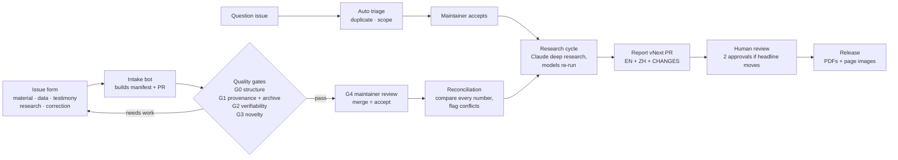

# How many died in China's 1959–61 famine

An open, versioned research project on the death toll of the Great Leap Forward famine (三年困难时期).
Anyone can submit documents, data, testimony, research or questions. Every submission passes automated
quality gates and human review, is reconciled against everything already known, and feeds a research
cycle that produces the next version of the report, in English and Chinese.

[中文说明](README.zh.md)

## Current findings (report v1.0, November 2026)

| | Estimate |
|---|---|
| **Excess deaths**, mid-1958 to mid-1963 | **≈31 million** (defensible range 22–40 million) |
| Calendar 1959–61 only | ≈27 million |
| Implied by registered (official) deaths | 14–16 million: a floor, since registration captured ~60% of deaths |
| Births lost or postponed | ≈36 million gross, ≈28 million net of the 1962–63 rebound (not deaths) |

Read the full report: [English](reports/v1.0/report_en.md) · [中文](reports/v1.0/report_zh.md) ·
PDFs in [`reports/v1.0/pdf/`](reports/v1.0/pdf/) and on the [Releases](../../releases) page.

The spread between published estimates (17 to 45 million) comes almost entirely from two assumptions: how
complete the 1953 and 1964 censuses were relative to each other, and what "normal" mortality would have been.
The report explains both, checks every major published estimate, and traces how the numbers first leaked and
were contested.

## How the project works



1. **Submit** through an [issue form](../../issues/new/choose). A bot turns it into a pull request with a
   machine-readable `manifest.yaml` ([docs/contributing](CONTRIBUTING.md)).
2. **Quality gates** run automatically: structure, provenance (with Wayback Machine archiving), verifiability
   and novelty ([docs/quality-gates.md](docs/quality-gates.md)). A maintainer then reviews; merging accepts it.
3. **Reconciliation** compares every number in the registry and in accepted submissions: same measure, same
   place, overlapping period. Disagreements become items in the research queue, proposed as a pull request
   ([docs/reconciliation.md](docs/reconciliation.md); latest run: [`reports/reconciliation/latest.md`](reports/reconciliation/latest.md)).
4. **Questions** are triaged automatically and accepted by maintainers into
   [`questions/questions.yaml`](questions/questions.yaml).
5. **Research cycle**: when enough has accumulated ([`pipeline/config.yaml`](pipeline/config.yaml)), a workflow
   assembles a research packet and runs Claude to investigate, re-run the models, and draft the next report
   version in both languages. The result is a pull request that humans review ([docs/pipeline.md](docs/pipeline.md)).
6. **Release**: merged reports are built into PDFs and per-page images and published as a GitHub release.

## Repository map

| Path | What it holds |
|---|---|
| `reports/vX.Y/` | Each report version: `report_en.md`, `report_zh.md`, figures, PDFs, `CHANGES.md`, `meta.yaml` |
| `research/vX.Y/` | Research notes and the packet behind each version; `research/queue.yaml` is the open research queue |
| `data/national/`, `data/regional/` | Census, registration, provincial and county datasets (CSV, each row sourced) |
| `data/registry/` | `estimates.yaml`, `claims.yaml` (every number, normalized), `sources.yaml` (graded A–D), `archive_snapshots.yaml` |
| `models/national/` | The cohort-component model behind the headline; `python models/national/famine_model.py` |
| `submissions/<type>/<id>/` | Accepted submissions with their manifests and files |
| `questions/questions.yaml` | Reader questions and their status |
| `pipeline/` | Intake, gates, reconciliation, triage, research packet, report build |
| `schemas/` | JSON Schemas for submissions, claims, questions |
| `docs/` | Methodology, quality gates, reconciliation, testimony policy, style guide, maintainer setup |

## Run it locally

```bash
pip install -r requirements.txt
python -m pipeline.validate          # gate 0 on everything
python -m pytest -q                  # pipeline tests
python -m pipeline.check_model       # re-runs the model, checks the headline (≈30.9M)
python -m pipeline.reconcile         # writes reports/reconciliation/latest.md
python -m pipeline.research_packet   # is a research cycle due?
python -m pipeline.build_report v1.0 --images   # needs pandoc, playwright chromium, fonts-noto-cjk, poppler
```

## Principles

- **Evidence over position.** Low and high estimates get the same scrutiny; disagreements are explained, not averaged.
- **Definitions matter.** Excess deaths, starvation deaths, total deaths and lost births are never mixed.
- **Every number has a source**, and every web source has an archived copy where possible.
- **Contributors are protected.** Real names are never required; testimony is anonymized ([policy](docs/testimony-policy.md)).
- **Machines draft, humans decide.** Automated research produces pull requests, never direct changes to `main`.

See [GOVERNANCE.md](GOVERNANCE.md) for roles and decision rules.

## License

Code: [MIT](LICENSE). Report text, data compilations and documentation: [CC BY 4.0](LICENSE-CONTENT.md).
Third-party material keeps its own license; we quote briefly and link. Cite as described in [CITATION.cff](CITATION.cff).
