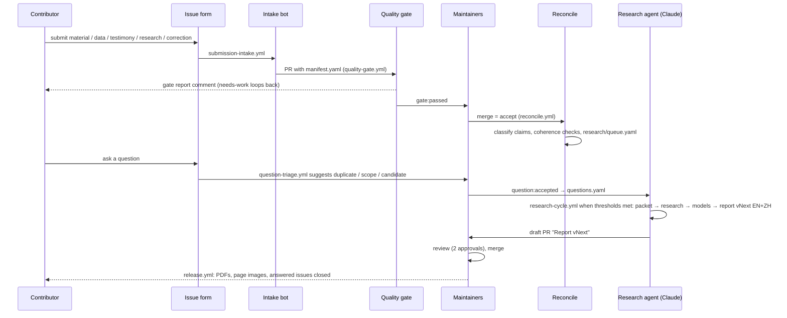

# Pipeline

How material moves from an issue to a published report. Each stage is a GitHub Actions workflow calling a
script in `pipeline/`; every script also runs locally.

## Stages

| Stage | Workflow | Script | Output |
|---|---|---|---|
| Intake | `submission-intake.yml` (issue opened/edited) | `intake_issue.py`, `archive_links.py`, `quality_gate.py` | Gate preview comment; PR with `submissions/<type>/<id>/` (first-time contributors: after `submission:triage-ok`) |
| Gates G0–G3 | `quality-gate.yml` (every PR; base-branch gate code) | `quality_gate.py` | Sticky PR comment, `gate:*` label, failing check if gates fail |
| CI | `ci.yml` (every PR and push) | `validate.py`, tests, `check_model.py`, `check_cycle.py` | Pass/fail |
| Approvals | `report-approvals.yml` | — | Fails until 2 approvals when a report version or the headline estimate changes |
| Reconciliation | `reconcile.yml` (merge to main, weekly) | `reconcile.py` | `bot/reconciliation` PR with `reports/reconciliation/latest.{md,json}` and `research/queue.yaml`; tracking issue |
| Question triage | `question-triage.yml` (question issues) | `triage_questions.py` | Comment + label; on `question:accepted`, a PR adding it to `questions.yaml` |
| Research cycle | `research-cycle.yml` (manual; monthly if `RESEARCH_CYCLE_SCHEDULE=enabled`; skipped while a `report:draft` PR is open) | `research_packet.py`, Claude, `check_cycle.py`, `build_report.py` | PR with `research/vNext/`, `reports/vNext/` (draft if checks fail) |
| Release | `release.yml` (new `reports/v*/meta.yaml` on main) | `build_report.py` | GitHub release with PDFs and page images; answered question issues closed |

## When a research cycle runs

`pipeline/config.yaml` sets the thresholds. A cycle is due when any is met: enough new accepted submissions,
enough open research-queue items, or enough accepted questions. Maintainers can force one from the Actions tab
(Research cycle → Run workflow → force). Each cycle handles at most `max_items_per_cycle` items; the rest wait.

## What the research agent may do

It runs with the instructions in `pipeline/prompts/research_cycle.md` and a narrow allowlist: it can read
everything, edit only `research/`, `reports/`, `data/` and `questions/`, search and fetch the web, and run a fixed
set of commands (validate, reconcile, model runs). It never sees the repository token, and any change it makes to
code (`pipeline/`, `models/*.py`, `schemas/`, `.github/`) is reverted before checks run. It does not commit, push or
merge; the workflow opens a pull request from an allowlist of paths, as a draft if the output checks fail.
Submissions and web pages are treated as untrusted data; instructions found inside them are ignored and flagged.
Residual risk: a prompt injection could still steer the agent's writing or its web requests, which is why every
report goes through two human approvals.

## Versioning

Reports are `vMAJOR.MINOR`. A minor version adds evidence or answers questions; a major version changes the
method or moves the headline range materially. Each version is immutable once released; corrections go into the next.
