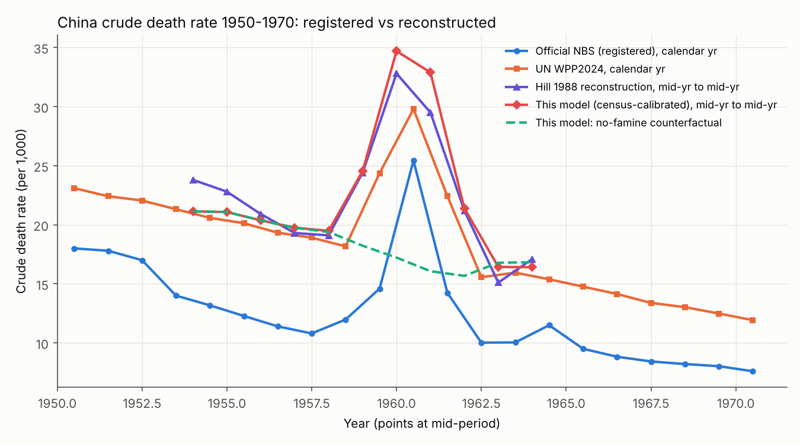
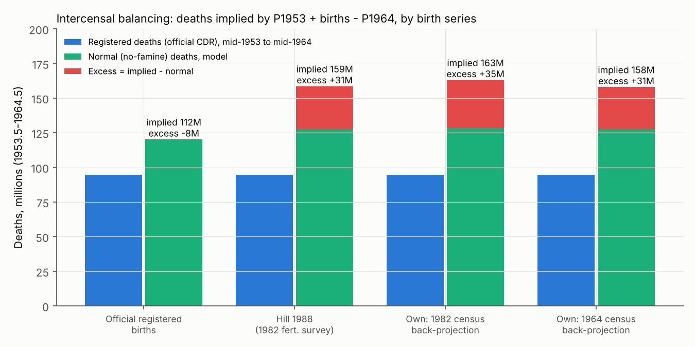
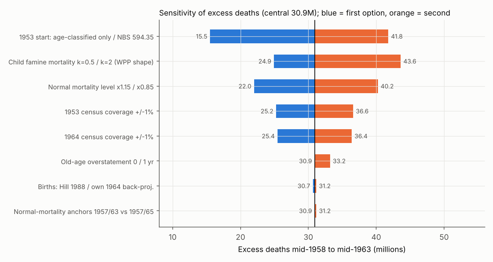
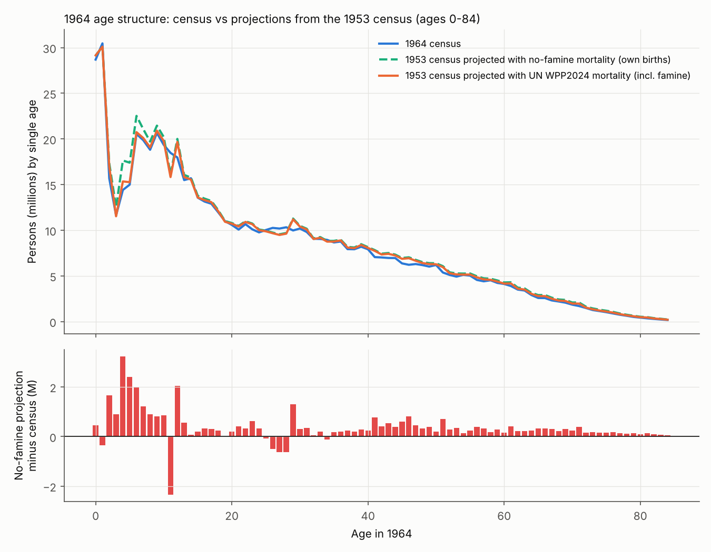
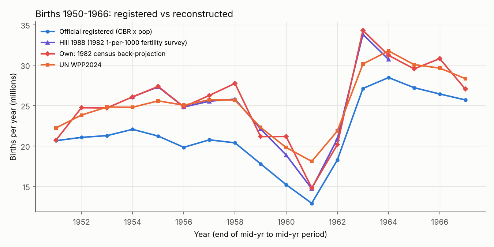

# How many died in China's 1959–61 famine

2026-11-01

**Our census-based central estimate is about 31 million excess deaths (mid-1958 to mid-1963), with a defensible range of 22–40 million (Monte Carlo interquartile range 26–38 million).** Calendar 1959–61 alone accounts for about 27 million. Registered (official) deaths imply only 14–16 million, which is a floor, because registration captured only about 60% of the deaths the censuses require. About 36 million births were lost or postponed (28 million net of the 1962–63 rebound); those are births that never happened, not deaths, so the total population deficit (人口损失) is about 59–67 million.

Excess deaths (超额死亡 / 非正常死亡) are all deaths above a no-famine counterfactual, including disease, child deaths and violence. Starvation deaths (饿死) are a subset the data cannot isolate. The Zhihu answer's "~30 million" is consistent with our figure, but several of its supporting calculations are wrong. The spread between published estimates (17 to 45 million) comes almost entirely from two assumptions: how complete the 1953 and 1964 censuses were relative to each other, and what "normal" mortality would have been.

## National estimate: five census routes converge near 31 million

### What the official series says, and what it cannot

The table in the Zhihu screenshot (from 《新中国50/55/60年统计资料汇编》) matches the official series first published in the *Statistical Yearbook of China 1983* ([Hill 1988](https://documents1.worldbank.org/curated/en/492811468771874832/pdf/Demographic-Trends-in-China-from-1950-to-1982.pdf); [NBS 1999](https://www.stats.gov.cn/yearbook/1999/d02c.htm)). Its death rates carry small copying slips: 1960 is printed 25.49‰ instead of 25.43‰, and the 1962 and 1963 values are swapped. These are transcription errors, not manipulation; the official birth, death and natural-increase rates are internally consistent.

**The year-end totals are not consistent with those rates.** In 1960 the registered population fell by exactly 10.00 million (67,207万 → 66,207万), but the reported natural increase of −4.57‰ explains only −3.05 million. That leaves an unexplained −6.95 million in 1960 and another −5.98 million in 1961. The residual is +7.5 million in 1958–59 and nets to −15.2 million over 1954–64. Projected from the 1953 census, registered births minus registered deaths overshoot the 1964 census by 17.2 million. Registered deaths of 94.8 million (mid-1953 to mid-1964) cover only about 60% of the ~159 million deaths the censuses imply.

Applying registered death rates to five different "normal" baselines gives **14.4–16.2 million excess deaths for 1958–61**, reproducing Yang Jisheng's NBS-based 1,619.92万 ([Yang lecture 2010](https://chinadigitaltimes.net/chinese/128188.html)). This is a floor: Hill estimated adult death registration at about 80% complete and child-death registration at only about 30%.

### The 1953 base: 582.6 million, not 594.35 million

NBS census tables list 59,435万 for 1953 ([NBS 2005 T4-4](https://www.stats.gov.cn/sj/ndsj/2005/html/D0404e.htm)), but that figure still includes about 11.7 million overseas Chinese and students (601.94M grand total minus Taiwan's 7.59M). The mainland total comparable with the 1964 count of 694.58 million is **582,603,417** ([NBS 1964 communiqué](https://www.stats.gov.cn/sj/tjgb/rkpcgb/qgrkpcgb/202302/t20230206_1901987.html)). Using 594.35M silently inflates any intercensal estimate by about 11 million (41.8M instead of 30.9M in our model).

### Four models

All models run mid-year to mid-year, because both the 1953 and 1964 censuses refer to 30 June. Model C, our central model, is a single-year, two-sex cohort-component reconstruction: it projects the 1953 census forward with a no-famine mortality schedule (UN WPP2024 single-age rates interpolated 1957→1963), adds births back-projected from the 1982 census, and solves for the famine mortality needed to reproduce the 1964 census exactly. An independent calibration of child mortality against Hill's survey-based births lands on the same child pattern (factor 1.05), which is a useful cross-check.

| Model                                               | Inputs                                       | Excess deaths (M) | Comment                                                      |
|-----------------------------------------------------|----------------------------------------------|-------------------|--------------------------------------------------------------|
| A. Registered death rate × baseline                 | NBS official, 1958–61                        | 14.4–16.2         | Floor; registration ~60% complete                            |
| A. Hill's reconstructed rates, simple baselines     | Hill 1988                                    | 20.5–25.7         | Flat or linear baseline                                      |
| B. Intercensal balancing, official births           | 1953 pop + births − 1964 pop                 | −8.3              | Impossible, so official births are too low                   |
| B. Intercensal balancing, Hill's survey births      | 270.7M births                                | **31.2**          |                                                              |
| B. Intercensal balancing, own 1964 back-projection  | 270.1M births                                | **30.7**          |                                                              |
| B. Intercensal balancing, own 1982 back-projection  | 275.1M births                                | **34.9**          | 3.9M from allocating 1982 military                           |
| **C. Census-calibrated cohort-component (central)** | 1953 & 1964 censuses + back-projected births | **30.9**          | 20.2M among people alive in 1953, 10.7M among later births   |
| D. UN WPP2024 / 2022                                | UN deaths series                             | 15.7–18.2         | Implicitly treats 1964 census as ~2.7% under-counted vs 1953 |

Model C's annual profile: 4.1M excess deaths in mid-1958–59, **11.5M in 1959–60, 11.2M in 1960–61**, 4.1M in 1961–62 and roughly zero in 1962–63. The reconstructed death rate peaks near 35‰ against a counterfactual of about 17‰. On a calendar-year basis that is roughly 2.1M (1958), 7.8M (1959), 11.3M (1960), 7.6M (1961) and 2.1M (1962), so **calendar 1959–61 ≈ 27 million**. The timing within years is borrowed from the UN's shape and is indicative only.

### Sensitivity: two assumptions decide almost everything

| Scenario                                                      | Excess deaths (M)          |
|---------------------------------------------------------------|----------------------------|
| **Central**                                                   | **30.9**                   |
| 1953 true population = census × 0.98 / 0.99 / 1.01 / 1.02     | 19.5 / 25.2 / 36.6 / 42.3  |
| 1964 true population = census × 0.98 / 0.99 / 1.01 / 1.02     | 41.9 / 36.4 / 25.4 / 19.9  |
| 1964 census under-counted 2.75% relative to 1953 (UN-implied) | 15.8                       |
| Both censuses under-counted by 1%                             | 31.1                       |
| 1953 base: age-classified 567.4M only / NBS 594.35M           | 15.5 / 41.8                |
| Normal mortality × 0.85 / × 1.15                              | 40.3 / 22.0                |
| Child famine mortality × 0.5 / × 2                            | 24.9 / 43.6                |
| Ages 50+ overstated by 1 year in both censuses                | 33.2                       |
| Monte Carlo (300 draws): median; 25–75%; 5–95%                | 32.1; 26.3–38.1; 14.7–46.9 |

**Each 1% shift in the relative completeness of the 1953 and 1964 censuses moves the answer by about ±5.5 million; each ±15% in normal mortality moves it by about ±9 million.** The single assumption that separates the UN's implicit ~16 million from our ~31 million is that the UN treats the 1964 census as about 2.7% under-counted relative to 1953. We found no published evidence for an undercount that size, and three points cut the other way: the 1953 census is generally considered less complete than 1964; duplicate registrations surviving into 1964 would inflate, not deflate, that count; and the 1964 census agrees with the 1982 census within ~1% for cohorts aged 0–45 in 1964. One finding pushes upward: projecting 1964 forward with UN mortality falls 8 million short of the 1982 census at ages 46+, suggesting the UN overstates normal adult mortality. That is why the upper end of the range sits near 40 million.

**How data manipulation could still bias us.** The estimate assumes the age-classified census counts are honest enumerations, that the 1982 census and fertility-survey birth histories are not systematically distorted, and that the famine age pattern borrowed from the UN is roughly right. Survivor-based surveys miss families that died out entirely ([Zhao & Reimondos 2012](https://shs.cairn.info/article/E_POPU_1202_0329?lang=en)), which biases reconstructed births, and therefore our deaths, slightly downward. No independent post-enumeration check of 1953 against 1964 coverage exists. Crucially, none of our census-based models uses the annual hukou registration totals, so manipulation of those year-end figures cannot drive our result.

### Our numbers against the literature

| Study                                      | Period       | Excess deaths (M)       | Lost births (M) | Method                            | What our model needs to reproduce it                 |
|--------------------------------------------|--------------|-------------------------|-----------------|-----------------------------------|------------------------------------------------------|
| Official registered rates (computed here)  | 1958–61      | 14.4–16.2               | —               | Registration                      | Floor                                                |
| Jiang Zhenghua & Li Nan 1986/87            | 1958–63      | 17 (16.5–17.9)          | —               | Life tables on official rates     | Normal mortality ~1.25× UN, or 1953 base ~2.5% lower |
| UN WPP2024 (computed here)                 | 1958–61      | 15.7                    | —               | UN reconstruction                 | 1964 census −2.75% vs 1953                           |
| Mi Hong & Jia Ning 2016                    | 1958–61      | 16.2–23.4               | —               | Modified Lee-Carter               | Implied normal death rate ~16.5‰                     |
| Li Chengrui 1997                           | famine years | ~22                     | —               | Amended Coale                     | Normal mortality ~1.15×                              |
| Peng Xizhe 1987                            | 1958–62      | ~23 (not verified)      | —               | Provincial records                | Near our 25th percentile                             |
| Coale 1984                                 | 1958–63      | 26.8 (24.8 for 1959–61) | 30.7            | Three censuses + survey           | Normal mortality ~1.07× UN                           |
| Calot 1985                                 | 1958–62      | 28.5                    | ~33.2           | Census-based                      | Agrees                                               |
| Luo Sheng 1988                             | 1959–63      | 28.9                    | —               | Brass logit                       | Agrees                                               |
| Banister 1987                              | 1958–61      | 29.9                    | 31.2            | Reconstruction                    | Agrees                                               |
| Ashton, Hill, Piazza & Zeitz 1984          | 1958–61      | ~30                     | 33              | Censuses + 1982 survey births     | Same inputs give 31.2                                |
| Cao Shuji 2005                             | 1959–61      | 32.5                    | —               | Prefecture gazetteers             | Agrees                                               |
| Jin Hui 1993                               | 1959–61      | 27.9–40.6               | —               | Balancing on published series     | Upper half of range                                  |
| Yang Jisheng 2008                          | 1958–62      | 36                      | 40              | Archives + judgement              | Upper half of range                                  |
| Dikötter 2010                              | 1958–62      | ≥45                     | —               | Cao + ~50% uplift                 | Outside range; needs a 10‰ baseline                  |
| Sun Jingxian / Yang Songlin / Cheng & Zhan | 1959–61      | 2.5–5                   | —               | Hukou accounting, raised baseline | Inconsistent with census totals                      |

Sources: [Mi, Yang & Jia (IUSSP)](https://iussp.org/sites/default/files/event_call_for_papers/A%20study%20of%20population%20change%20led%20by%20China%E2%80%99s%20great%20famine_.pdf); [Cao 2005](https://chinadigitaltimes.net/chinese/?p=98017); [Jin Hui 1993](https://www.aisixiang.com/data/11995.html); [人口研究 2016](https://rkyj.ruc.edu.cn/CN/Y2016/V40/I1/22); [Ó Gráda 2011](https://www.ucd.ie/economics/t4media/WP11_03.pdf); [Yang Songlin (Springer)](https://link.springer.com/chapter/10.1007/978-981-16-1661-7_7); [人口研究 2017](https://rkyj.ruc.edu.cn/CN/Y2017/V41/I2/97).

**One reconciliation worth noting.** Hill's published annual death rates (19.1‰ in 1957–58, rising to 32.8‰ in 1959–60) give only 20.5–25.7 million with a naive flat or linear baseline, below the "some 30 million" he and Ashton state. Their figure implies a counterfactual that keeps falling, to about 15–16‰ by 1961; ours falls from 19.4‰ to 15.7‰ and yields 30.9 million. Every estimate is a pair of choices: how much famine-year death went unrecorded, and what "normal" would have been.

## The Zhihu answer: right headline, faulty arithmetic

The chenqin answer replies to Lin Zhibo's (林治波) Weibo posts of 29–30 April **2012** (not 2013), which were deleted within days; Lin posted an apology on 1 May ([CDT/RFI](https://chinadigitaltimes.net/chinese/223180.html)). Its bottom line holds; most of its supporting calculations do not.

| Claim in the answer                                                                     | Verdict                                     | Evidence                                                                                                                                                                                                                          |
|-----------------------------------------------------------------------------------------|---------------------------------------------|-----------------------------------------------------------------------------------------------------------------------------------------------------------------------------------------------------------------------------------|
| "饿死" ≠ "非正常死亡"; most excess deaths are disease worsened by malnutrition          | **Holds**                                   | Standard demographic definition                                                                                                                                                                                                   |
| The exact 1,000万 drop in 1960 may have been made up after 1982 ("拍脑袋") as a decoy   | **Not supported**                           | It is the published registration series, which closes on the 1964 census within 0.5%. The drop mixes ~3M registered natural decrease with ~7M register write-offs or unregistered deaths: neither a fabrication nor a death count |
| Official birth and death rates are understated, so official data *under*-state deaths   | **Holds**                                   | Registered deaths give 14–16M vs ~31M; births under-registered every year 1953–63                                                                                                                                                 |
| ~30M in 1959–61 has been beyond doubt since the 1982 census                             | **Partly**                                  | 27–30M has been the modal census-based figure since 1984, but state-linked work gave 17M and 22M, and serious estimates span 17–45M                                                                                               |
| A 1964→1982 projection fits the 1982 census, validating the method                      | **Partly**                                  | We get a similar fit at ages 18–45 but an 8M shortfall at 46+; the fit tests 1964–82 mortality, not the level of the 1957 life table                                                                                              |
| 1964 under-10 population exceeds the counterfactual, so registered births are too low   | **Holds**                                   | Survey births exceed registered births by ~46–51M over 1953–64                                                                                                                                                                    |
| The 40+ population in 1964 is **29.57M** short of the counterfactual                    | **Not reproducible at realistic mortality** | We get 13.0M (8.5–16.4M); 29.57M needs normal mortality ~0.65–0.70× UN levels                                                                                                                                                     |
| Large-scale "少生" did not happen; nearly all the shortfall is excess deaths            | **Fails**                                   | Births fell from ~27M to ~15M a year; ~36M gross lost births                                                                                                                                                                      |
| Male 40-year-old death risk in the 1957 / 1963 / 1981 life tables = 5.47 / 3.42 / 2.53‰ | **Unverified, implausibly low**             | UN WPP2022 gives 10.3 / 8.7 / 4.3‰; original tables not found                                                                                                                                                                     |
| ~7M normal deaths a year; 30M over 3 years raises the death rate from 1% to 2.5%        | **Registration-level arithmetic**           | Modeled normal deaths ~10–12.5M a year (16–19‰); true peak ~33–35‰                                                                                                                                                                |
| If all 30M fell on ages 40+, their death rates rose 7×                                  | **Arithmetic error**                        | 2.8× against age-specific rates; 4.2× even on the post's own numbers                                                                                                                                                              |
| Most people "couldn't feel" 30M deaths                                                  | **Partly**                                  | True of cities (Shanghai's death rate never exceeded 7.8‰); false in hotspots with 100–250‰ and whole households extinguished                                                                                                     |

**The 29.57 million "40+ gap".** We projected the 1953 census to 1964 without births and compared ages 40+ (158.94 million in the 1964 census). With normal mortality consistent with the reconstructed age structure, the gap is **13.0 million**. It rises to 19.8M at 0.85× that mortality and 27.3M at 0.70×; only at about 0.65–0.70× (female life expectancy ~58–61 in the late 1950s, the level of a registration-based official life table) does 29.57M appear. Because adult death registration was only ~80% complete, such a counterfactual counts eleven years of unregistered *normal* deaths as famine deaths; 20% under-registration alone inflates the gap by ~12.5 million. There is also an internal contradiction: 29.6M at 40+, plus ~7M among younger 1953 cohorts, plus ~10.7M among children born after 1953, would push the total toward 47 million, contradicting the post's own 30 million. The method cannot see child deaths at all.

**The "7×" multiplier.** People 40+ were about 153.9 million (23.5%) in 1960, with about 5.5 million normal deaths a year (36‰). Ten million extra deaths a year on that group is a **2.8×** multiplier; even with the post's 7 million normal deaths and a 45% share at 40+, it is 4.2×. The 7× figure appears exactly if one applies the flat national death rate (~10.8‰) to the 40+ population: 1.65M normal deaths, so (1.65 + 10) / 1.65 ≈ 7.1. That treats population share as death share, when in reality old-age deaths dominate normal mortality. A true 7× on every 40+ age-specific rate for three years would mean about 58 million deaths at 40+ alone, with 45% of 70-year-olds dying each year.

**Lost births** are the post's weakest point. Survey-based births and our 1982 back-projection both show births falling from about 27 million to about 15 million in 1960–61, with fertility dropping from 6.07 to 3.39 children per woman ([Hill 1988](https://documents1.worldbank.org/curated/en/492811468771874832/pdf/Demographic-Trends-in-China-from-1950-to-1982.pdf)). The post's own 1982 chart shows the hole at ages 20–22. Its correct observation that registered births were too low means births fell from a higher level than registered, not that they did not fall.

## Three common objections, answered

### 1. "The data are obviously defective: end-1960 is exactly 10 million below end-1959"

**The round number is real and the registration series is defective, but neither affects the census-based estimate, because that estimate never uses the year-end totals.**

What the numbers are. Before 1982, China's annual population figures were Ministry of Public Security household-registration (户籍) counts, not surveys; NBS says so itself ([NBS reply, 2024](https://www.stats.gov.cn/hd/lyzx/zxgk/202407/t20240719_1955729.html)). The 1960 figure was compiled by the ministry's Third Bureau household section and first published in the 1983 Statistical Yearbook and the 1988 《人口统计资料汇编》, co-edited by NBS and the Third Bureau ([学习公社](https://library.ttcdw.com/libary/wenhuakejisuyang/zx/2017-05-10/134417.html)). Both totals are rounded to 10,000, so a difference of exactly 1,000.0万 is an unlikely coincidence; the 1960 total may well have been rounded or estimated by the ministry. We cannot test that without the unrounded counts.

What is clearly wrong is the bookkeeping, which Jin Hui spotted in 1993 ([aisixiang](https://www.aisixiang.com/data/11995.html)): the year-end totals and the published birth and death rates cannot both be right.

| Year | Change in year-end total (M) | Registered births − deaths (M) | Unexplained residual (M) |
|------|------------------------------|--------------------------------|--------------------------|
| 1957 | +18.25                       | +14.81                         | +3.44                    |
| 1958 | +13.41                       | +11.26                         | +2.15                    |
| 1959 | +12.13                       | +6.79                          | +5.34                    |
| 1960 | −10.00                       | −3.05                          | **−6.95**                |
| 1961 | −3.48                        | +2.50                          | **−5.98**                |
| 1962 | +14.36                       | +17.97                         | −3.61                    |
| 1963 | +18.77                       | +22.74                         | −3.97                    |
| 1964 | +13.27                       | +19.30                         | −6.03                    |

There are two competing readings of the residual:

- **Register clean-up of people who never existed.** Sun Jingxian argues that 11.4–11.6 million duplicate registrations made during the 1956–59 rural-to-urban migration were cancelled in 1960–64 ([Sun, 乌有之乡](https://www.wyzxwk.com/Article/lishi/2011/12/271132.html)). The positive residuals of 1956–59 (+11.8M) fit this, and it is a legitimate point.

- **Write-offs of deaths that were never recorded.** Deaths hidden during the famine stayed on the books until bulk cancellation. Even Sun's own accounting includes 7.5 million unreported deaths later written off ([Sun, 知乎 repost](https://zhuanlan.zhihu.com/p/1973792853676279168)).

Sun's further claim, that about 14.8 million *living* people fell off the registers in 1960–64 and were re-registered only in 1965–79, can be tested against the 1964 census, which counted people present. If 14.8 million real people were missing from the registers in mid-1964, the census should exceed the register. Instead, the register (mid-1964 ≈ 698.4M, averaging end-1963 691.72M and end-1964 704.99M) *exceeds* the census (694.58M) by about 3.8 million. The 1964 census was organized together with a household-register check, so some unregistered people could have been missed by both; but nothing in the census suggests a hidden 15 million.

Why our estimate is unaffected. Our models start from the 1953 census, end at the 1964 census, and take births from survivors counted in the 1964 and 1982 censuses and the 1982 fertility survey. The 1959 and 1960 year-end totals never enter. If the 1960 figure had been invented after 1982, as some critics allege, the census-based toll would be unchanged. An error in 1960 would also have to be offset by an opposite error in 1961–64, because the register lands on the 1964 census within 0.5% and on the 1982 census within 0.01%.

### 2. "Why did the population grow so much in 1962?"

**1962 is the famine's mirror image: food returned, deaths fell to a record low, and couples made up postponed births.** It is evidence for a famine, not against one.

- **Food came back.** The Centre retreated from Great Leap policies in 1961–62: communal mess halls were dissolved, procurement quotas cut, private plots and markets restored, and grain imported from 1961. Hill's reconstruction shows the death rate falling from about 33‰ in 1959–60 to about 15‰ by 1962–63 ([Hill 1988](https://documents1.worldbank.org/curated/en/492811468771874832/pdf/Demographic-Trends-in-China-from-1950-to-1982.pdf)).

- **Deaths fell below the pre-famine level** (registered 10.02‰ in 1962, against 10.80‰ in 1957). Part of this is a "harvesting" effect: the frail had already died, so the surviving population was, briefly, unusually robust. Part is renewed under-registration.

- **Births rebounded sharply.** Registered births jumped from 11.9 million (1961) to 24.6 million (1962) and 29.6 million (1963); the registered birth rate went from 18.02‰ to 37.01‰ and 43.37‰. Survey-based reconstruction gives 33.8 million births in mid-1962–63 and a fertility rate of 7.55 children per woman, the highest of the period ([Hill 1988](https://documents1.worldbank.org/curated/en/492811468771874832/pdf/Demographic-Trends-in-China-from-1950-to-1982.pdf)). Women's fecundity returned with food, marriages postponed during 1959–61 took place, spouses separated by labor drafts were reunited (over 26 million urban residents were sent back to villages in 1961–63), and families replaced children who had died. Post-famine baby booms are a standard pattern ([Zhao & Reimondos 2012](https://shs.cairn.info/article/E_POPU_1202_0329?lang=en)).

The rebound was large but it did not erase the deficit. Our reconstruction shows about 35.8 million births lost in 1958–61 and about 7.4 million of them made up in 1962–64, leaving 28.4 million net. Note too that 1962's registered growth (+14.36M) is 3.6 million *less* than its registered births minus deaths: the register was still writing people off.

### 3. "How much of the 'excess deaths' is really children who were never born?"

**In our 31 million, none. Lost births are estimated separately (28–36 million) and are not counted as deaths.** Confusion arises because many popular figures are population deficits that mix the two.

The mechanism the question describes is real. Famine suppresses births through amenorrhea and lower fecundity, postponed marriage, spousal separation and deliberate postponement ([Zhao & Reimondos 2012](https://shs.cairn.info/article/E_POPU_1202_0329?lang=en)). Even the official registers show it: registered births fell from 21.7 million in 1957 to 11.9 million in 1961, about 25 million fewer births over 1958–61 than at the 1957 level. That shortfall is real, large and almost exactly as big as the deaths.

How the two are kept apart. A demographic accounting identity drives every census-based estimate: deaths = population at the start + births − population at the end. It uses the births that *actually happened*, measured from survivors and from women's own birth histories in the 1982 fertility survey (which record every child born, including those who later died). A birth that never happened lowers the births term and therefore lowers the deaths implied; it cannot be counted as a death.

| Component of the 1958–64 shortfall                                            | Size (M) | Can "fewer births" explain it?                                                     |
|-------------------------------------------------------------------------------|----------|------------------------------------------------------------------------------------|
| Excess deaths among people already alive at the 1953 census (age 11+ in 1964) | 20.2     | **No.** They were born before the famine; only death removes them                  |
| Excess deaths among children born 1953–64                                     | 10.7     | Only if the birth estimate is too high; every 1M too many births adds 1M to deaths |
| **Excess deaths, total**                                                      | **30.9** |                                                                                    |
| Births lost or postponed, 1958–61 (gross)                                     | 35.8     | These are the unborn                                                               |
| …of which made up in the 1962–64 boom                                         | −7.4     |                                                                                    |
| **Net lost births**                                                           | **28.4** |                                                                                    |
| **Total population deficit by mid-1964**                                      | **≈59**  | About half deaths, half unborn                                                     |

Where the residual uncertainty is. The 10.7 million child deaths depend on the birth estimate. Hill's survey-based births (270.7M for mid-1953 to mid-1964) and our census back-projection (270.1M) agree within 0.6 million, and calibrating child mortality to them gives the same child pattern; halving or doubling child famine mortality moves the total to 24.9–43.6 million. So the honest answer is that a few million of the child component is uncertain, but the 20 million adult component cannot be an artifact of fewer births at all.

Which figures do mix the two. Jin Hui's 45.22 million "少增加人口" (1959–61), the 52.59 million shortfall against trend in one widely reposted calculation ([CDT](https://chinadigitaltimes.net/chinese/162450.html)) and Yang Jisheng's 76 million total loss are population deficits. Read as death tolls they are roughly double counted; read as deficits they are consistent with ours.

## Regions: Sichuan and Anhui carried half the toll, rural China nearly all of it

### Provincial death rates and estimates

Six provinces (Sichuan, Anhui, Henan, Shandong, Guizhou, Hunan) account for about 76–77% of excess deaths in both the registered data and Cao Shuji's reconstruction. **Sichuan and Anhui held about one-sixth of China's pre-famine population but nearly half its excess deaths.** Meanwhile Shanghai's death rate never rose above 7.8‰.

Official provincial death rates (‰) come from an SSB table citing 《人口统计资料汇编 1949–1985》 ([mirror](http://www.yhcw.net/famine/Research/fmtab123.htm); the [bannedbook.org original](https://www.bannedbook.org/books/famine/Research/fmtab123.htm) was unreachable), cross-checked against NBS series (e.g. [Jiangsu](https://population.gotohui.com/show-84758), [Shanghai](https://population.gotohui.com/show-84821)) and [Zhao & Reimondos 2012](https://shs.cairn.info/article/E_POPU_1202_0329?lang=en). "Simple excess" is our recomputation: (death rate − 1956–57 mean) × population, summing positive years 1958–62. It reproduces the published [大饥荒档案 table](http://www.yhcw.net/famine/Data/ExDeath01.html) within ±5万 for 25 of 28 units. Cao's figures are his county-gazetteer reconstruction ([Cao 2005](https://chinadigitaltimes.net/chinese/?p=98017); [provincial table](https://chinadigitaltimes.net/chinese/215281.html)).

| Province          | 1957  | 1958  | 1959  | 1960            | 1961  | 1962  | Simple excess (万) | 大饥荒档案 (万) | Cao 2005 (万) | Cao, % of pop. |
|-------------------|-------|-------|-------|-----------------|-------|-------|--------------------|-----------------|---------------|----------------|
| Sichuan (revised) | 12.1  | 25.17 | 46.9  | 53.97           | 29.42 | 14.82 | 773                | 778             | 940           | 13.1           |
| Anhui             | 9.1   | 12.36 | 16.72 | **68.58**       | 8.11  | 8.51  | 209                | 203             | 633           | **18.4**       |
| Henan             | 11.8  | 12.69 | 14.1  | 39.65           | 10.2  | 8.04  | 138                | 134             | 294           | 6.1            |
| Shandong          | 12.05 | 12.77 | 18.14 | 23.51           | 18.49 | 12.35 | 131                | 128             | 181           | 3.4            |
| Guizhou           | 12.35 | 15.26 | 20.28 | 52.33 (or 45.4) | 23.27 | 11.64 | 102                | 52 (?)          | 175           | 10.2           |
| Hunan             | 10.35 | 11.58 | 12.92 | 29.26           | 17.48 | 10.23 | 100                | 98              | 249           | 6.8            |
| Guangxi           | 12.42 | 11.98 | 17.33 | 29.20           | 20.37 | 10.15 | 65                 | 64              | 93            | 4.6            |
| Gansu             | 11.33 | 21.11 | 17.38 | 41.32           | 11.48 | 8.25  | 59                 | 63              | 102           | 6.5            |
| Jiangsu           | 10.26 | 9.40  | 14.55 | 18.41           | 13.35 | 10.36 | 49                 | 49              | 153           | 2.9            |
| Hubei             | 9.61  | 9.60  | 14.49 | 21.22           | 9.08  | 8.77  | 48                 | 48              | 68            | 2.2            |
| Liaoning          | 9.4   | 8.8   | 11.8  | 11.5            | 17.5  | 8.5   | 46                 | 42              | \<50          | 1.7            |
| Yunnan            | 16.29 | 21.62 | 17.96 | 26.26           | 11.84 | 10.86 | 36                 | 38              | 80            | 4.2            |
| Guangdong         | 8.42  | 9.15  | 11.76 | 15.09           | 10.67 | 9.32  | 28                 | 27              | 66            | 1.7            |
| Jilin             | 9.05  | 9.12  | 13.43 | 10.13           | 11.12 | 9.96  | 17                 | 17              | \<50          | —              |
| Fujian            | 9.02  | 7.50  | 7.95  | 15.61           | 12.18 | 8.28  | 16                 | 17              | \<50          | 2.0            |
| Hebei             | 11.59 | 10.92 | 12.31 | 12.19           | 13.34 | 8.97  | 14                 | 30 (?)          | 61            | 1.1            |
| Zhejiang          | 9.32  | 9.15  | 10.81 | 11.88           | 9.84  | 8.61  | 11                 | 11              | \<50          | 0.5            |
| Shaanxi           | 10.31 | 11.04 | 12.76 | 12.27           | 8.76  | 9.35  | 11                 | 11              | \<50          | 1.0            |
| Jiangxi           | 11.47 | 11.33 | 13.01 | 16.06           | 11.54 | 11.00 | 10                 | 10              | \<50          | 1.1            |
| Qinghai           | 10.4  | 12.64 | 16.29 | 40.73           | 11.68 | 5.35  | 10                 | 11              | \<50          | —              |
| Heilongjiang      | 10.45 | 9.17  | 12.76 | 10.52           | 11.12 | 8.62  | 6                  | 6               | \<50          | 1.2            |
| Shanxi            | 12.68 | 11.73 | 12.84 | 14.21           | 12.20 | 11.34 | 5                  | 5               | \<50          | 0.4            |
| Beijing           | 8.19  | 8.08  | 9.66  | 9.14            | 10.80 | 8.77  | 5                  | 4               | \<50          | —              |
| Shanghai          | 6.10  | 6.20  | 7.80  | 6.90            | 7.70  | 7.20  | 4                  | 2               | \<50          | —              |
| Xinjiang          | 14.0  | 13.0  | 18.84 | 15.67           | 11.71 | 9.71  | 4                  | 4               | excluded      | —              |
| Ningxia           | —     | 14.1  | 15.81 | 13.88           | 10.71 | 8.49  | 2                  | 2               | \<50          | —              |
| Inner Mongolia    | 10.5  | 7.9   | 11.0  | 9.4             | 8.8   | 9.0   | 2                  | 2               | excluded      | —              |
| Tianjin           | 9.35  | 8.66  | 9.88  | 10.34           | 9.89  | 7.36  | 2                  | 2               | \<50          | —              |
| **Total**         |       |       |       |                 |       |       | **1,901**          | **1,856**       | **3,246**     |                |

Tibet has no published series. Conflicts we reconciled:

- **Sichuan has two official series.** The 1988 compendium's older series (17.37‰ in 1958, 19.22, 47.78, 28.01) removes about 2 million Sichuan excess deaths compared with the revised series above, so regression datasets built on it understate Sichuan. Yang Jisheng's printed "15.17" for 1958 is a typo for 25.17.

- **Guizhou 1960 is unresolved:** 52.33‰ (SSB, Yang) vs 45.4‰ (Zhao & Reimondos). With 45.4 our simple excess drops from 102万 to about 85万.

- **Hunan 1960 is 29.26‰**, not Yang's 29.42 (which duplicates Sichuan's 1961 value).

- **Hebei's 大饥荒档案 figure (29.5万) is double ours**, possibly because it includes Tianjin (administered by Hebei for most of 1958–66; not verified).

### Provinces against the national estimate

**Official provincial data sum to 17.3–19.0 million**, 7–17% above the ~16.2 million from the national series, because each province contributes only its own above-baseline years. **Cao's 32.5 million is about 1.7× the official provincial sum, almost exactly the ratio of our census-based 31 million to the 15–16 million registered floor.** Two independent routes, county gazetteers and national census balancing, imply the same degree of death under-registration.

That ratio varies sharply by province: about 1.2× in Sichuan, whose official series was already catastrophic, but 3.0× in Anhui and 3.2× in Jiangsu. Anhui's official 1961 death rate of 8.11‰ sits *below* its pre-famine level right after a 68.58‰ year, which points to under-reporting plus very heavy out-migration (~55‰ in 1960 per Ó Gráda). Officials' private numbers ran higher: Liao Bokang put Sichuan at 12 million, An Ziwen put Anhui at 5 million, Wan Li at 3–4 million ([刘放 review](https://chinadigitaltimes.net/chinese/238625.html)). The 10.6 million Sichuan deaths Dikötter cites from police records are *total* deaths, which leaves roughly 6.5–7.5 million excess.

Politics shaped the map. Sichuan shipped out 15.5% of its 1959 grain (vs 1.8% for Jiangsu) and supplied 31.5% of all provincial grain exports; provinces led by alternate Central Committee members procured 2.8–3.9 points more grain ([Kung & Chen, APSR 2011](https://Www.Gwern.net/doc/sociology/abandoned-footnotes/2011-kung.pdf)). Several northern units (Liaoning, Beijing, Hebei) peaked in 1961, after urban grain supplies were squeezed.

### Hotspot counties and where each number first appeared

County death rates above 100‰ come from data compiled by 王维志 (Wang Weizhi, a Ministry of Public Security demographer) and published in Yang Jisheng's 《墓碑》 (2008). **Forty counties exceeded 100‰ in 1960** (11 in Anhui, 11 in Sichuan, 10 in Henan, 4 in Guizhou, 3 in Qinghai, 1 in Guangxi), and 675 exceeded 20‰ ([陈子明 review](https://www.aisixiang.com/data/24241.html)). The official 《中国共产党历史》 vol. 2 (2011) itself concedes nine Xinyang counties above 100‰ ([via CDT](https://chinadigitaltimes.net/chinese/?p=165596)).

| Locality                  | Figure                                          | What it measures                        | Earliest known source                    | Where first public / read                                                                       |
|---------------------------|-------------------------------------------------|-----------------------------------------|------------------------------------------|-------------------------------------------------------------------------------------------------|
| Xinyang prefecture, Henan | 436,882                                         | Total deaths to mid-1960                | Henan work-team report, 18 Jun 1960      | Quoted by Sun Jingxian ([aisixiang](https://www.aisixiang.com/data/71783.html))                 |
| Xinyang prefecture        | 1,070,321 (13.2%)                               | Abnormal deaths, Nov 1959–Oct 1960      | Prefecture's last report to the Centre   | [CDT repost](https://chinadigitaltimes.net/chinese/215281.html)                                 |
| Xinyang prefecture        | "100多万"                                       | Oral statement                          | Tao Zhu, ~Apr 1961                       | [VOA via CDT](https://chinadigitaltimes.net/chinese/166472.html)                                |
| Guangshan, Henan          | 246.77‰; Huaidian commune 12,134 of 36,691 dead | 1960 death rate; deaths                 | Wang Weizhi; report of 28 Nov 1960       | 《墓碑》 2008                                                                                   |
| Huaibin, Henan            | 383.2‰                                          | 1960 death rate (Yang's own data)       | —                                        | 《墓碑》                                                                                        |
| Fengyang, Anhui           | 60,245 deaths; 8,404 households wiped out       | Deaths 1959–60                          | 陈振亚《关于凤阳问题的报告》, 1 Feb 1961 | Hong Kong 《开放》, Mar 1994 ([CDT](https://chinadigitaltimes.net/chinese/?p=110963))           |
| Wuwei / Taihe / Bo, Anhui | 182.3 / 174.8 / 162.4‰                          | 1960 death rate                         | Wang Weizhi                              | 《墓碑》                                                                                        |
| Fuyang prefecture, Anhui  | 1.5M / \>2M / 2.4M                              | Deaths, three versions                  | 1960s report to Liu Shaoqi; others       | Jin Hui 1993 ([aisixiang](https://www.aisixiang.com/data/11995.html))                           |
| Meitan, Guizhou           | 124,510 deaths (\>20%); 240.16‰                 | Nov 1959–Apr 1960                       | Wang Weizhi / internal                   | [Yang lecture](https://chinadigitaltimes.net/chinese/?p=103671)                                 |
| Yingjing / Rong, Sichuan  | 175.4 / 164.7‰                                  | 1960 death rate                         | Wang Weizhi                              | 《墓碑》                                                                                        |
| Tongwei, Gansu            | −98,251 (32%)                                   | Population decline 1959–61              | 《通渭县志》 1990                        | [CDT](https://chinadigitaltimes.net/chinese/?p=553044)                                          |
| Shandong province         | 650,000 + 1.09M out-migrants                    | Non-normal deaths, winter 1958–mid 1960 | Gov. Zhao Jianmin, 15 Dec 1960           | 《墓碑》                                                                                        |
| Gaoyou, Jiangsu           | 37,000+ starved (17,000+ children)              | Deaths 1959–61                          | 《高邮县志》                             | [CDT](https://chinadigitaltimes.net/chinese/215281.html)                                        |
| Linxia city, Gansu        | 41,381 (Yang) vs 1,230 (city gazetteer)         | Disputed                                | —                                        | Yang conceded a city/prefecture mix-up ([CDT](https://chinadigitaltimes.net/chinese/?p=326690)) |
| Jiabiangou camp, Gansu    | ~3,000 held; no documented death total          | Labour camp                             | 杨显惠《夹边沟记事》, 2000               | [CDT](https://chinadigitaltimes.net/chinese/?p=552797)                                          |

The Xinyang sequence shows how numbers escalate inside the system: 436,882 total deaths in June 1960, 549,171 in a November 1960 provincial report, then 1.07 million abnormal deaths in the prefecture's final report. At commune level, Sanbeisi first reported 523 deaths and a work team found 6,668. First reports far below later investigations are why registration-based totals are floors. Some disputes are real, though: in Changde, Sun set Yang's formula estimate of ~146,000 against ~6,000 recorded oedema deaths, which compares all-cause excess with a single cause of death.

### Rural China absorbed about 90% of excess deaths

**In 1960 the official rural (县) death rate was 28.58‰ against 13.77‰ in cities (市): 2.58× the 1957 rural level against 1.63× the urban one** ([Lin & Yang 2000](https://gwern.net/doc/sociology/2000-lin.pdf), citing the 1991 Statistical Yearbook; we did not see the yearbook page). On these data about **91% of 1958–61 excess deaths were rural**, and since under-registration was concentrated in the countryside the true share was likely higher. Urban hukou holders had legal grain entitlements; peasants got what remained after procurement. Rural children had about 1.9× the odds of dying at ages 0–2. In Anhui the urban death rate rose 260% while the rural one rose almost eightfold. The 1961–63 downsizing (精简) sent over 26 million urban residents back to villages ([aisixiang](https://www.aisixiang.com/data/82837.html)), mostly after the mortality peak.

## Who died: infants at the highest rates, men over 40 in the largest numbers

Which group was "resilient" depends on whether you count rates or heads.

**By rate, the famine was most lethal for infants and young children.** Reconstructed infant mortality peaked at roughly 200–285 per 1,000 births (144 in 1957–58 per Hill). In the six worst-hit provinces, survival to age 10 fell from 76% under 1957 conditions to 59–60% under 1959–60 conditions ([Zhao & Reimondos 2012](https://shs.cairn.info/article/E_POPU_1202_0329?lang=en)). Life expectancy fell to about 31–33 years (Hill: male 30.7 in 1959–60; Zhao & Reimondos: 32.5 in 1960). We could not verify the often-quoted "~25 years in 1960" attributed to Ashton et al.

**By number, adults and the elderly bore most of the excess.** Hill attributes about 70–78% of excess deaths to ages 10+, and finds a sharp break in survival for people aged 35+ in 1953, "especially for males", plausibly because rationing favoured working-age people ([Hill 1988](https://documents1.worldbank.org/curated/en/492811468771874832/pdf/Demographic-Trends-in-China-from-1950-to-1982.pdf)). Our reconstruction agrees:

| Group (age in 1964)               | Excess deaths (M) |
|-----------------------------------|-------------------|
| Born after the 1953 census (0–10) | 10.7              |
| 11–19, 20–29, 30–39               | 1.4–1.9 each      |
| 40–49                             | 4.9               |
| 50–59                             | 3.1               |
| 60–69                             | 2.7               |
| 70+                               | 2.4               |
| **All alive in 1953**             | **20.2 (65%)**    |

**Young adults (15–39) were the most resilient**, with the smallest proportional rise in mortality (about 1.6×, against 2.6× at ages 1–4), consistent with work-point rationing and mobility. Falling births also limited child deaths in absolute terms: Hill's under-10 deaths in 1960–61 (3.26M) were *below* 1957–58 (5.19M) because far fewer children were being born.

**Men died at higher rates than women in every reconstruction**: excess death rates of 13–18‰ for men vs 8.5–13‰ for women across the NBS, Coale, Banister, Calot and Jiang series, so men were about 57–61% of excess deaths ([Mu & Zhang, IFPRI](https://ageconsearch.umn.edu/record/42331/files/ifpridp00760.pdf)). That is the standard famine pattern. The exception was early childhood: girls aged 1–4 died at higher rates than boys, which Zhao & Reimondos attribute to son preference. The cohorts still carry the mark: in the 2000 census, rural cohorts born in 1958 had 109.6 males per 100 females but those born in 1961 had 100.3.

**Lost births were as large as the deaths.** Against the pre-famine birth rate (~43‰), our reconstruction gives **35.8 million births lost in 1958–61 and 28.4 million net** after the 1962–63 rebound, when births reached 33.8 million with a fertility rate of 7.55. Published figures bracket this: Hill 33M, Coale 30.7M, Banister 31.2M, Yang 31.5M (NBS-based) or 40M (his own). In the 1990 census, rural cohorts born 1959–61 are only ~72% the size of 1954–57 cohorts, against ~85% for non-agricultural ones ([Meng, Qian & Yared](https://eml.berkeley.edu/~webfac/bardhan/qian.pdf)). Shanghai lost about 140,000 births with almost no excess deaths. The holes in the age pyramid (ages 2–5 in 1964, 20–23 in 1982) mix unborn children with infants who died, so cohort-size gaps must not be read as death counts.

## How the numbers leaked and were contested

**No national death figure appeared in public anywhere between 1959 and 1980.** The first open number was a death rate (Sun Yefang, 1981), the first totals were Western census reconstructions (1984), and "about 30 million" became the default through convergence of independent methods, not through any authoritative pronouncement.

### Timeline, 1959–2024 (oldest first)

| Date           | Event                                            | Figure                                                               | Venue / route to public                                                                                                                  |
|----------------|--------------------------------------------------|----------------------------------------------------------------------|------------------------------------------------------------------------------------------------------------------------------------------|
| 23 May 1959    | Propaganda Dept bulletin 《宣教动态》            | 6,700+ "oedema" deaths in 11 provinces                               | Internal; quoted in 《墓碑》 ([aisixiang](https://www.aisixiang.com/data/24241.html))                                                    |
| 18 Jun 1960    | Work-team report on Xinyang                      | 436,882 deaths                                                       | Internal; quoted by Sun ([aisixiang](https://www.aisixiang.com/data/71783.html))                                                         |
| 15 Dec 1960    | Shandong Gov. Zhao Jianmin                       | 650,000 non-normal deaths                                            | Internal; 《墓碑》                                                                                                                       |
| 1 Feb 1961     | Chen Zhenya, Fengyang report                     | 60,245 deaths                                                        | Leaked to Hong Kong 《开放》, Mar 1994                                                                                                   |
| 4 Apr 1961     | US intelligence estimate SNIE 13-61              | None: "widespread famine does not appear to be at hand"              | [FRUS](https://history.state.gov/historicaldocuments/frus1961-63v22/d17)                                                                 |
| 1961           | Grain Ministry / SSB survey                      | "全国人口减少了几千万", reportedly destroyed (contested)             | Yang's account; disputed by Sun                                                                                                          |
| Jan–Feb 1962   | Seven Thousand Cadres Conference                 | "三分天灾，七分人祸"; no number                                      | Internal                                                                                                                                 |
| 1962           | Hong Kong refugee wave                           | ~140,000 entrants; no death count                                    | Consular debriefings                                                                                                                     |
| 25 Nov 1980    | Restricted 《农业经济丛刊》 Liyuan study         | One commune 5,730 → 2,870                                            | Translated in [NYRB 1983](https://www.nybooks.com/articles/1983/06/16/starving-to-death-in-china/)                                       |
| 15 Feb 1981    | Sun Yefang, 《经济管理》 no. 2                   | Death rate 10.8‰ (1957) → 25.4‰ (1960)                               | First open PRC famine death rate                                                                                                         |
| 27 Jun 1981    | Resolution on Party History                      | "serious losses"; no number                                          | [Text](https://www.marxistarkiv.se/kina/engelska/on_cpc_history.pdf)                                                                     |
| 1983           | *Statistical Yearbook 1983*                      | Full vital series; 1960 population −10M                              | The table in the Zhihu screenshot                                                                                                        |
| 1984           | Coale, *Rapid Population Change in China*        | ~27M                                                                 | National Academy Press                                                                                                                   |
| 11 Sep 1984    | SSB spokesman Xu Gang to AP                      | "certainly more than 10 million"                                     | First official PRC national statement ([AP via SAILDART](https://www.saildart.org/FAMINE.NS%5BE84,JMC%5D))                               |
| Dec 1984       | Ashton, Hill, Piazza & Zeitz, *PDR*              | ~30M + 33M lost births                                               | [IHSN](https://catalog.ihsn.org/citations/46705)                                                                                         |
| 1985           | IUSSP Florence conference                        | Banister 29.9M; Calot 28.5M                                          | Former SSB head Li Chengrui shares data                                                                                                  |
| 1986/87        | Jiang Zhenghua & Li Nan (state-commissioned)     | 17M                                                                  | 《中国人口年霴1987》 ([CDT](https://chinadigitaltimes.net/chinese/363046.html))                                                          |
| 1987           | Banister book; Peng Xizhe, *PDR*                 | ~30M; ~23M                                                           | Books and journals                                                                                                                       |
| 1988           | Hill (World Bank); Luo Sheng                     | ~30M; 28.9M                                                          | [World Bank](https://documents1.worldbank.org/curated/en/492811468771874832/pdf/Demographic-Trends-in-China-from-1950-to-1982.pdf)       |
| 1989           | CAS 《生存与发展》                               | ~15M died of malnutrition                                            | Cited by Jin Hui                                                                                                                         |
| 1991           | Ding Shu, 《人祸》 (Hong Kong)                   | 35M+                                                                 | [minjian-danganguan](https://minjian-danganguan.org/archive/466)                                                                         |
| 1993           | Jin Hui, 《社会》 nos. 4–5                       | 27.9M up to 40.6M                                                    | [aisixiang](https://www.aisixiang.com/data/11995.html)                                                                                   |
| Jul 1994       | Chen Yizi, via Washington Post                   | 43M                                                                  | [Moscow Times reprint](https://www.themoscowtimes.com/archive/reports-tell-horror-of-maos-policies)                                      |
| 1996           | Becker, *Hungry Ghosts*                          | 30–60M                                                               | Book                                                                                                                                     |
| 1997           | Li Chengrui, 《中共党史研究》 no. 2              | 22M                                                                  | Highest figure in an official Party journal                                                                                              |
| 2005           | Cao Shuji, 《中国人口科学》; 《大饥荒》          | 32.5M                                                                | [CDT](https://chinadigitaltimes.net/chinese/?p=98017)                                                                                    |
| 2008           | Yang Jisheng, 《墓碑》 (Hong Kong)               | 36M + 40M lost births                                                | Banned on mainland                                                                                                                       |
| 2010           | Dikötter, *Mao's Great Famine*                   | ≥45M                                                                 | [Ó Gráda critique](https://www.ucd.ie/economics/t4media/WP11_03.pdf)                                                                     |
| Jan 2011       | 《中国共产党历史》 vol. 2                        | 1960 population −10M (a net decline, not a death count)              | [VOA via CDT](https://chinadigitaltimes.net/chinese/166472.html)                                                                         |
| 2011           | Sun Jingxian, 《马克思主义研究》 no. 6           | "重大谣言"; 3.66M                                                    | [CDT](https://chinadigitaltimes.net/chinese/252335.html)                                                                                 |
| 29–30 Apr 2012 | Lin Zhibo's Weibo posts; chenqin's Zhihu reply   | Lin denies "几千万"; posts deleted                                   | [CDT](https://chinadigitaltimes.net/chinese/223180.html)                                                                                 |
| 20 May 2013    | Weibo post citing 37.55M deleted                 | —                                                                    | [CDT River Crab Archive](https://chinadigitaltimes.net/2013/06/river-crab-archive-the-death-toll-from-maos-great-famine/)                |
| Sep 2013       | Sun: ≤2.5M "营养性死亡"                          | Trends on Weibo                                                      | [Global Voices](https://globalvoices.org/2013/09/07/dont-say-millions-starved-during-chinas-great-famine-try-nutritional-death-instead/) |
| 2013           | Yang Songlin, 《总要有人说出真相》               | ≤4M                                                                  | Book                                                                                                                                     |
| 22 Sep 2014    | CASS article in Xinhua, People's Daily           | "Hostile Western forces" exaggerate the toll                         | [chinanews](https://www.chinanews.com.cn/gn/2014/09-22/6614931.shtml)                                                                    |
| 17 Jul 2016    | 《炎黄春秋》 ceases publication                  | —                                                                    | [CDT](https://chinadigitaltimes.net/2016/07/liberal-journal-yanhuang-chunqiu-says-will-end-publication/)                                 |
| 2016 / 2017    | Mi & Jia; Cheng Enfu & Zhan Zhihua, 《人口研究》 | 16.2–23.4M; 4–5M                                                     | [2016](https://rkyj.ruc.edu.cn/CN/Y2016/V40/I1/22), [2017](https://rkyj.ruc.edu.cn/CN/Y2017/V41/I2/97)                                   |
| Nov 2021       | Third history resolution                         | Great Leap named an "error"; 1981's "serious losses" wording dropped | [Text](https://id.china-embassy.gov.cn/ztbd/jrzg/202111/t20211118_10450069.htm)                                                          |
| 2024           | UN WPP2024 (computed here)                       | ~16–18M implied                                                      | [wpp2024](https://github.com/PPgp/wpp2024)                                                                                               |

### Phase 1, 1959–80: secrecy

Inside the Party, counts circulated only at prefecture and province level, and as early as May 1959 the bulletins recorded "oedema" rather than starvation. Abroad, US intelligence in April 1961 judged that famine was not at hand; Hong Kong consular officers debriefed refugees but "didn't have hard numbers" ([ADST oral histories](https://adst.org/2015/06/the-esoteric-art-of-china-watching-during-the-great-leap-forward/)). Edgar Snow publicly dismissed famine reports, and in 1966 Zhou Enlai still spoke of "great natural disasters" ([Wilson Center](https://digitalarchive.wilsoncenter.org/document/117703)).

### Phase 2, 1980–88: sanctioned data, Western totals

The first numbers to come out were sanctioned. Sun Yefang printed the 1960 death rate in February 1981; the 1982 census and the 1983 *Statistical Yearbook* followed with the full series. Western demographers immediately combined the yearbook, the 1982 census age structure and the 1982 one-per-thousand fertility survey. Smil recalls first American calculations of 16.6–23 million that rose to 23–30 million in more detailed work ([ENN/Smil](https://ennonline.net/fex/10/china)). Coale and Ashton et al. both published in 1984. The PRC's first national statement, "certainly more than 10 million" to AP in September 1984, was a reaction to those Western figures. Beijing then commissioned Jiang Zhenghua's 17 million, which leans on official death rates and is generally treated as a lower bound.

### Phase 3, 1989–2010: émigré leaks and the archival turn

After 1989 the high end arrived through émigrés. Chen Yizi's 43–46 million, attributed to an internal System Reform Institute study, was first verifiably reported in 1994; its documents were never released, and the institute's former director denied the project existed. Inside China, the decisive work came from local records: Jin Hui (1993) showed that published population totals and natural-increase rates cannot both be true; Cao Shuji (2005) summed over a thousand county gazetteers to reach 32.5 million; Yang Jisheng (2008) combined twelve provincial archives to settle on 36 million ([ChinaFile](https://www.chinafile.com/library/nyrb-china-archive/finding-facts-about-maos-victims)). Dikötter's "at least 45 million" (2010) added about 50% to Cao. Ó Gráda objected that archival totals do not separate normal from crisis deaths and that Dikötter's 10‰ baseline is implausibly low, against a probable true pre-famine rate near 25‰ ([Ó Gráda 2011](https://www.ucd.ie/economics/t4media/WP11_03.pdf)).

### Phase 4, 2011–present: official minimization and censorship

The 2011 Party History acknowledged the 10 million population decline but gave no death toll. From 2011 a minimization camp (Sun Jingxian, Yang Songlin, later Cheng Enfu) published in Party-affiliated venues, 《墓碑》 was banned, Yang was forced out of 《炎黄春秋》 in 2015, and the magazine closed in 2016. Specialist opinion meanwhile settled on a range: Ó Gráda's 18–32.5 million, the New York Times' "20 to 30 million or more" ([MCLC](https://lists.osu.edu/pipermail/mclc/2013-October/002361.html)).

## The denial side, stated fairly

**The minimization estimates (2.5–5 million) rest on hukou bookkeeping and one-sided baseline corrections; census age structures, which never touch the hukou registers, rule them out.**

**The argument.** Sun Jingxian, a mathematician, defines "abnormal population change" as the change in registered population minus (registered births − registered deaths). He finds a 1960–64 anomaly of about 26.44 million and attributes it to migration-registration errors: double registration during the 1958–60 urban hiring boom, unrecorded moves, and "pocket hukou" (口袋户口) during the 1961–63 downsizing, followed by bulk cancellation ([Sun 2016](https://rpb115.nsysu.edu.tw/var/file/131/1131/img/2375/CCPS2(1)-Sun.pdf); [Sun, 红旗文稿](https://www.aisixiang.com/data/71783.html)). Yang Songlin uses linear mortality-trend baselines to get 2.6–4 million ([Springer](https://link.springer.com/chapter/10.1007/978-981-16-1661-7_7)); Cheng Enfu and Zhan Zhihua raise the baseline to correct for 1953–57 death under-reporting and get 4–5 million.

**What they get right.** The +7.5 million registration residual in 1958–59 does fit double registration during the hiring boom. Starvation is a narrower category than excess mortality. Some 《墓碑》 figures are total rather than excess deaths, and Yang conceded the Linxia error. Dikötter's baseline is indeed inconsistent.

**Why the totals fail.**

1.  **Double counting nets out once cancelled.** The 1954–64 residual nets to −15.2 million, and survey births show the register also missed tens of millions of births, so the missing deaths must be larger, not smaller.

2.  **The bulk write-off *is* the anomaly.** Unreported deaths stay on the books until a later write-off (about 8 million in 1964, per statistician Wang Weizhi), which shows up exactly as the "abnormal change" Sun attributes to migration ([Yang's rebuttal](https://chinadigitaltimes.net/chinese/252335.html)).

3.  **The unregistered could not eat.** Under grain rationing, millions of unregistered survivors are implausible.

4.  **Census estimates never use hukou totals.** A census counts people present regardless of registration; duplicates surviving into 1964 would bias census estimates *down*. No internal migration error can create a national shortfall in the 1964 census or the 1982 age structure.

5.  **The baseline is corrected on one side only.** Raising "normal" deaths for under-registration without raising famine-year deaths likewise is the mirror image of Dikötter's error.

Survivor-based evidence (fertility-survey child survival, 1990-census cohort deficits) is independent of hukou bookkeeping and shows a mortality crisis far larger than 2.5–5 million ([Meng, Qian & Yared](https://www.kellogg.northwestern.edu/faculty/qian/resources/MPQY_FINAL.pdf)).

## Deleted sources, surviving copies, and open questions

The chenqin answer itself is gone from Zhihu, but the Internet Archive holds full copies; most other deletions are social-media posts and the closed 《炎黄春秋》, and nearly every key text survives somewhere. Checked 1 Nov 2026 against the Wayback Machine.

| Source                                                                                                                 | Status today                                                                                                              | Best surviving copy                                                                                                                                                                                                                                                                                                                      |
|------------------------------------------------------------------------------------------------------------------------|---------------------------------------------------------------------------------------------------------------------------|------------------------------------------------------------------------------------------------------------------------------------------------------------------------------------------------------------------------------------------------------------------------------------------------------------------------------------------|
| chenqin's Zhihu answer ([question 20207577, answer 14334544](https://www.zhihu.com/question/20207577/answer/14334544)) | Deleted: 404 from June 2016; question page shows Zhihu's not-found page by Dec 2023                                       | [Wayback, 3 May 2012](https://web.archive.org/web/20120503050513/http://www.zhihu.com:80/question/20207577/answer/14334544) to [13 May 2013](https://web.archive.org/web/20130513154728/http://www.zhihu.com/question/20207577/answer/14334544); the question was retitled from "三年大饥荒" to "三年自然灾害" on 3 May 2012             |
| Lin Zhibo's Weibo denials, 29 Apr 2012 (six posts)                                                                     | Deleted by 2 May 2012                                                                                                     | No text archived: every Wayback capture is a login redirect. His [profile on 2 May 2012](https://web.archive.org/web/20120502045608/http://weibo.com:80/linzhibo) shows his 1 May apology ("我对大跃进那段历史缺乏研究") and the denials already gone; wording survives via [RFI/CDT](https://chinadigitaltimes.net/chinese/223180.html) |
| @凤凰台张婉 post citing 37.55M, 20 May 2013                                                                            | Censored by Sina                                                                                                          | [FreeWeibo capture, Aug 2014](https://web.archive.org/web/20140811104752/https://freeweibo.com/weibo/3580144918951255); [CDT River Crab Archive](https://chinadigitaltimes.net/2013/06/river-crab-archive-the-death-toll-from-maos-great-famine/)                                                                                        |
| ifeng: Sun Jingxian's 2.5M "营养性死亡", 6 Sep 2013                                                                    | Redirects to homepage                                                                                                     | Wayback 8 Sep 2013 – 16 Jul 2016 (news.ifeng.com/mainland/detail_2013_09/06/29371448_0.shtml)                                                                                                                                                                                                                                            |
| Yang Jisheng, 《驳“饿死三千万是谣言”》, 《炎黄春秋》 2013 no. 12                                                       | Site unreachable; page 404 from Nov 2020                                                                                  | [Full text, Wayback 3 Nov 2020](https://web.archive.org/web/20201103/http://www.yhcqw.com/71/9352.html)                                                                                                                                                                                                                                  |
| Yang Jisheng, 《关于大饥荒年代人口损失的讨论》, 《炎黄春秋》 2014 no. 9                                                | Site unreachable                                                                                                          | [Wayback 2014–17](https://web.archive.org/web/20140928083325/http://www.yhcqw.com/html/zml/2014/99/1499152593JA8596114653IDEJEJH96AK.html) keeps title only (body loaded by AJAX); text via [CDT mirror](https://chinadigitaltimes.net/chinese/363046.html)                                                                              |
| Yang's 2012 rebuttal of Sun, 《脱离实际必然走向谬误》                                                                  | Live on [NYT Chinese](https://cn.nytimes.com/china/20120917/cc17yangpreface/)                                             | [Full-text PDF, Wayback 18 Sep 2012](https://web.archive.org/web/20120918072600/http://cn.nytimes.com/article/china/2012/09/17/cc17yangpreface/cc17yangpreface.pdf)                                                                                                                                                                      |
| 共识网 (21ccom.net)                                                                                                    | Whole site offline ("站点已暂停")                                                                                         | No article from the Cao/Yang/Sun debate located in the archive; the debate survives as reposts on aisixiang and elsewhere                                                                                                                                                                                                                |
| 《墓碑》 (Yang Jisheng)                                                                                                | Banned on mainland                                                                                                        | [PDF, minjian-danganguan](https://www.minjian-danganguan.org/s/minjian-danganguan/item/458)                                                                                                                                                                                                                                              |
| SSB provincial death-rate table (fmtab123) and 大饥荒档案 provincial excess table (ExDeath01, dated 5 Jun 2000)        | Live on [bannedbook.org](https://www.bannedbook.org/books/famine/Research/fmtab123.htm) and yhcw.net                      | Earliest: [chinafamine.org, Oct 2002](https://web.archive.org/web/20021019224201/http://www.chinafamine.org:80/famine/Research/fmtab123.htm) and [May 2002](https://web.archive.org/web/20020510123938/http://chinafamine.org:80/famine/Data/ExDeath01.html)                                                                             |
| Jin Hui 1993, 《“三年自然灾害”备忘录》                                                                                 | Live on [aisixiang](https://www.aisixiang.com/data/11995.html)                                                            | Earliest online copy: [chinafamine.org, Oct 2002](https://web.archive.org/web/20021005100231/http://www.chinafamine.org:80/famine/Research/r020901a.htm), ten years before aisixiang                                                                                                                                                     |
| Sun Jingxian 2011, 《马克思主义研究》 no. 6                                                                            | CASS [table of contents](http://marxism.cass.cn/qkynj/mkszyyj/201109/t20110922_1973063.shtml) live; no official full text | Reposts on wyzxwk and others                                                                                                                                                                                                                                                                                                             |
| zh.wikipedia 三年困难时期                                                                                              | Live, blocked on mainland                                                                                                 | [zh.wikipedia](https://zh.wikipedia.org/wiki/三年困难时期)                                                                                                                                                                                                                                                                               |

**What we could not verify.** We could not tell whether the Zhihu question is still live (login wall), recover the text of Lin Zhibo's original posts, find any 21ccom article from the core debate, or find a pre-2002 online copy of Jin Hui. Also unconfirmed from primary sources:

- Peng Xizhe's 1987 provincial table, and the original texts of Ashton et al. (1984), Coale (1984), Banister (1987), Jiang & Li, and Li Chengrui (1997); their figures here come via secondary summaries.

- The 1957 and 1963 official life tables the Zhihu answer relies on, and the unrounded 1959/1960 household-register counts.

- Who made the first "16.6–23 million" American calculations; the title of Sun Yefang's 1981 article; the date of Chen Yizi's first written claim; the source of Liu Shaoqi's "人相食，要上书的" remark (quoted only secondhand).

- The "3,755.8万 archives tally" (attributed to 曹思源 via 《争鸣》), whose 1961 value differs between reposts.

- Most important of all: no independent evidence exists on the relative completeness of the 1953 and 1964 censuses, the single assumption that moves our estimate most.

## Sources

Our own model results come from Python scripts run on census age data (1953, 1964, 1982), the official NBS vital series, Hill's 1988 survey-based births and the UN WPP2022/2024 datasets; the scripts, input CSVs and result tables are delivered alongside this doc.

- [Hill 1988, *Demographic Trends in China from 1950 to 1982*, World Bank](https://documents1.worldbank.org/curated/en/492811468771874832/pdf/Demographic-Trends-in-China-from-1950-to-1982.pdf)

- [NBS 1999 yearbook](https://www.stats.gov.cn/yearbook/1999/d02c.htm); [NBS 2005 Table 4-4](https://www.stats.gov.cn/sj/ndsj/2005/html/D0404e.htm); [1964 census communiqué](https://www.stats.gov.cn/sj/tjgb/rkpcgb/qgrkpcgb/202302/t20230206_1901987.html)

- [UN WPP2022 R package](https://github.com/PPgp/wpp2022); [WPP2024](https://github.com/PPgp/wpp2024)

- [Zhao & Reimondos 2012, *Population*](https://shs.cairn.info/article/E_POPU_1202_0329?lang=en)

- [Cao Shuji 2005 (CDT repost)](https://chinadigitaltimes.net/chinese/?p=98017)

- [Yang Jisheng, 2010 lecture](https://chinadigitaltimes.net/chinese/128188.html); [Yang lecture on hotspots](https://chinadigitaltimes.net/chinese/?p=103671); [Yang's rebuttal of Sun](https://chinadigitaltimes.net/chinese/252335.html)

- [Jin Hui 1993, 《三年自然灾害备忘录》](https://www.aisixiang.com/data/11995.html)

- [陈子明 review of 《墓碑》](https://www.aisixiang.com/data/24241.html)

- [Sun Jingxian, 红旗文稿](https://www.aisixiang.com/data/71783.html); [Sun 2016, CCPS](https://rpb115.nsysu.edu.tw/var/file/131/1131/img/2375/CCPS2(1)-Sun.pdf)

- [Ó Gráda 2011, "Great Leap into Famine"](https://www.ucd.ie/economics/t4media/WP11_03.pdf)

- [Mi, Yang & Jia, IUSSP paper](https://iussp.org/sites/default/files/event_call_for_papers/A%20study%20of%20population%20change%20led%20by%20China%E2%80%99s%20great%20famine_.pdf); [人口研究 2016](https://rkyj.ruc.edu.cn/CN/Y2016/V40/I1/22); [人口研究 2017](https://rkyj.ruc.edu.cn/CN/Y2017/V41/I2/97)

- [Lin & Yang 2000, *Economic Journal*](https://gwern.net/doc/sociology/2000-lin.pdf); [Kung & Chen 2011, APSR](https://Www.Gwern.net/doc/sociology/abandoned-footnotes/2011-kung.pdf)

- [Mu & Zhang, IFPRI DP760](https://ageconsearch.umn.edu/record/42331/files/ifpridp00760.pdf); [Meng, Qian & Yared](https://www.kellogg.northwestern.edu/faculty/qian/resources/MPQY_FINAL.pdf)

- [SSB provincial death rates (mirror)](http://www.yhcw.net/famine/Research/fmtab123.htm); [大饥荒档案 provincial excess table](http://www.yhcw.net/famine/Data/ExDeath01.html)

- [NYRB 1983, "Starving to Death in China"](https://www.nybooks.com/articles/1983/06/16/starving-to-death-in-china/); [AP 1984 via SAILDART](https://www.saildart.org/FAMINE.NS%5BE84,JMC%5D); [FRUS SNIE 13-61](https://history.state.gov/historicaldocuments/frus1961-63v22/d17); [ADST oral histories](https://adst.org/2015/06/the-esoteric-art-of-china-watching-during-the-great-leap-forward/)

- [CDT on Lin Zhibo, 2012](https://chinadigitaltimes.net/chinese/223180.html); [CDT River Crab Archive 2013](https://chinadigitaltimes.net/2013/06/river-crab-archive-the-death-toll-from-maos-great-famine/); [Global Voices 2013](https://globalvoices.org/2013/09/07/dont-say-millions-starved-during-chinas-great-famine-try-nutritional-death-instead/)

- [NBS reply on pre-1982 data sources (2024)](https://www.stats.gov.cn/hd/lyzx/zxgk/202407/t20240719_1955729.html); [学习公社 on the 1960 figure](https://library.ttcdw.com/libary/wenhuakejisuyang/zx/2017-05-10/134417.html); [Sun Jingxian, 乌有之乡 2011](https://www.wyzxwk.com/Article/lishi/2011/12/271132.html); [Sun Jingxian, 知乎 repost](https://zhuanlan.zhihu.com/p/1973792853676279168)
