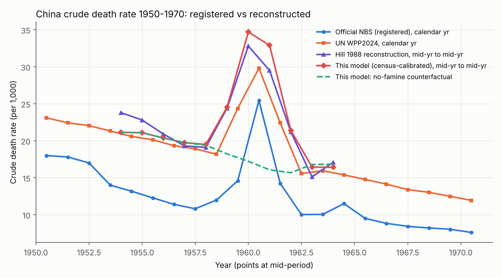
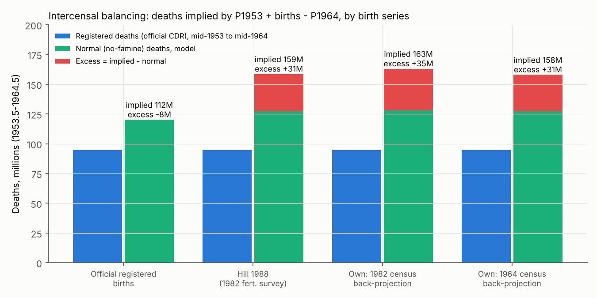
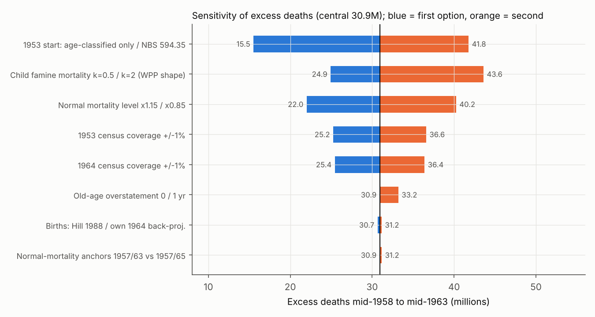
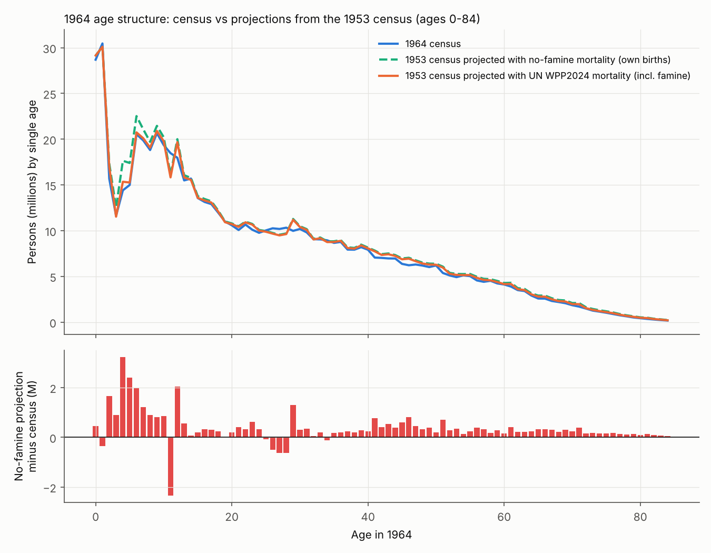
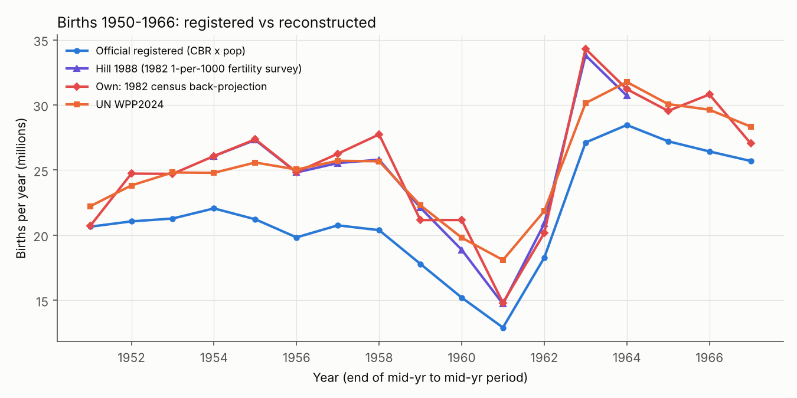

# 1959–61年中国大饥荒死亡人数研究（中文版）

2026-11-01

**根据人口普查数据重建，我们的中心估计是约3100万超额死亡（1958年年中至1963年年中），可辩护区间为2200万–4000万（蒙特卡洛四分位区间2600万–3800万）。** 仅1959–61三个日历年约为2700万。仅凭登记死亡数只能得出1400万–1600万超额死亡，这只是下限，因为户籍登记只捕捉到普查所要求死亡人数的约60%。此外约有3600万人少生或推迟出生（扣除1962–63年补偿性生育后净少生约2800万）；这些是从未出生的人，不是死亡，因此总人口损失约为5900万–6700万。

超额死亡（非正常死亡）指高于无饥荒反事实水平的全部死亡，包括疾病、儿童死亡和暴力致死；“饿死”只是其中一部分，数据无法单独分离。知乎回答中“三千万左右”的结论与我们的估计一致，但其多项支撑计算有误。已发表估计从1700万到4500万不等，差异几乎全部来自两个假设：1953年与1964年普查的相对完整程度，以及“正常”死亡率应取多高。

## 全国估算：五条普查路径汇聚在约3100万

### 官方序列说明了什么，又无法说明什么

知乎截图中的表格（出自《新中国50/55/60年统计资料汇编》）与1983年《中国统计年鉴》首次公布的官方序列一致（[Hill 1988](https://documents1.worldbank.org/curated/en/492811468771874832/pdf/Demographic-Trends-in-China-from-1950-to-1982.pdf)；[国家统计局1999](https://www.stats.gov.cn/yearbook/1999/d02c.htm)）。其死亡率有少量抄写错误：1960年应为25.43‰而非25.49‰，1962与1963年数值互换。这些是转录错误，不是篡改；官方出生率、死亡率和自然增长率三者本身是自洽的。

**但年末总人口与这些比率对不上。** 1960年登记人口恰好减少1000万（67207万→66207万），而公布的自然增长率−4.57‰只能解释其中305万。这意味着1960年有695万无法解释，1961年又有598万。该残差在1958–59年为+750万，1954–64年净额为−1520万。从1953年普查出发，用登记出生减登记死亡推算，会比1964年普查多出1720万。这段时期（1953年中至1964年中）登记死亡9480万，只是普查所隐含的约1.59亿死亡的约60%。

将登记死亡率与五种不同的“正常”基线比较，**1958–61年超额死亡为1440万–1620万**，与杨继绳依据国家统计局数据算出的1619.92万一致（[杨继绳2010年演讲](https://chinadigitaltimes.net/chinese/128188.html)）。这只是下限：Hill估计成人死亡登记完整度约80%，儿童死亡登记仅约30%。

### 1953年基数：5.826亿，而非5.9435亿

国家统计局普查汇总表列出1953年为59435万（[统计局2005年表4-4](https://www.stats.gov.cn/sj/ndsj/2005/html/D0404e.htm)），但该数仍包含约1170万华侨和留学生（6.0194亿总数减台湾7590万）。与1964年普查的6.9458亿可比的大陆人口是**582,603,417**（[1964年普查公报](https://www.stats.gov.cn/sj/tjgb/rkpcgb/qgrkpcgb/202302/t20230206_1901987.html)）。误用5.9435亿会使任何普查间推算虚增约1100万（我们模型中由3090万变为4180万）。

### 四种模型

所有模型均按年中至年中计算，因为1953年和1964年普查的标准时点都是6月30日。中心模型C是单岁、分性别的队列要素重建：以无饥荒死亡模式（联合国WPP2024单岁死亡率，1957→1963年插值）将1953年普查人口向前推算，加上由1982年普查反推的出生数，再求解使之恰好吻合1964年普查所需的饥荒死亡。用Hill基于生育调查的独立出生数校准儿童死亡，得到几乎相同的儿童死亡模式（系数1.05），是一个有用的交叉检验。

| 模型                                | 输入                    | 超额死亡（万） | 说明                                     |
|-------------------------------------|-------------------------|----------------|------------------------------------------|
| A. 登记死亡率 × 基线                | 国家统计局官方，1958–61 | 1440–1620      | 下限；登记完整度约60%                    |
| A. Hill重建死亡率，简单基线         | Hill 1988               | 2050–2570      | 平直或线性基线                           |
| B. 普查间平衡，官方出生数           | 1953人口+出生−1964人口  | −830           | 不可能，说明官方出生数偏低               |
| B. 普查间平衡，Hill调查出生数       | 2.707亿出生             | **3120**       |                                          |
| B. 普查间平衡，按1964年普查反推     | 2.701亿出生             | **3070**       |                                          |
| B. 普查间平衡，按1982年普查反推     | 2.751亿出生             | **3490**       | 其中390万来自1982年军人分配              |
| **C. 普查校准队列要素模型（中心）** | 1953、1964普查+反推出生 | **3090**       | 1953年在世者中2020万，此后出生者中1070万 |
| D. 联合国WPP2024/2022               | 联合国死亡序列          | 1570–1820      | 隐含1964年普查比1953年漏登约2.7%         |

模型C的年度分布：1958–59年度410万，**1959–60年度1150万，1960–61年度1120万**，1961–62年度410万，1962–63年度接近为零。重建死亡率峰值约35‰，反事实水平约17‰。换算为日历年大致为：1958年210万、1959年780万、1960年1130万、1961年760万、1962年210万，**即日历1959–61年约2700万**。年内时间分布借自联合国模式，仅供参考。

### 敏感性：两个假设决定了几乎一切

| 情景                                              | 超额死亡（万）             |
|---------------------------------------------------|----------------------------|
| **中心估计**                                      | **3090**                   |
| 1953年真实人口 = 普查 × 0.98 / 0.99 / 1.01 / 1.02 | 1950 / 2520 / 3660 / 4230  |
| 1964年真实人口 = 普查 × 0.98 / 0.99 / 1.01 / 1.02 | 4190 / 3640 / 2540 / 1990  |
| 1964年普查比1953年相对漏登2.75%（联合国隐含）     | 1580                       |
| 两次普查均漏登1%                                  | 3110                       |
| 1953年基数：仅分年龄部分5.674亿 / 统计局5.9435亿  | 1550 / 4180                |
| 正常死亡水平 × 0.85 / × 1.15                      | 4030 / 2200                |
| 儿童饥荒死亡 × 0.5 / × 2                          | 2490 / 4360                |
| 两次普查50岁以上年龄都多报1岁                     | 3320                       |
| 蒙特卡洛（300次）：中位数；25–75%；5–95%          | 3210；2630–3810；1470–4690 |

**1953年与1964年普查相对完整度每偏移1%，结果变动约±550万；正常死亡水平每变动±15%，结果变动约±900万。** 联合国隐含的约1600万与我们的约3100万之间的差别，只在于联合国将1964年普查视为比1953年漏登约2.7%。我们未找到支持如此大漏登的证据，而且有三点相反的证据：一般认为1953年普查比1964年更不完整；延续到1964年的重复登记只会抬高而非压低其人数；1964年普查与1982年普查对1964年0–45岁队列的吻合度在1%以内。另有一点推高：用联合国死亡率将1964年人口推到1982年，46岁以上比1982年普查少800万，说明联合国高估了正常成人死亡率，这就是区间上限接近4000万的原因。

**数据篡改仍可能如何影响我们。** 本估计假设分年龄普查数是如实普查结果、1982年普查和生育调查的生育史没有系统性扭曲、借用的联合国饥荒年龄模式大致正确。基于幸存者的调查会漏掉全家死绝的家庭（[Zhao & Reimondos 2012](https://shs.cairn.info/article/E_POPU_1202_0329?lang=en)），使重建出生数从而我们的死亡数略偏低。1953年与1964年普查覆盖率之间没有独立的事后核查。关键在于，我们的普查模型都不使用年度户籍总数，因此对年末数字的任何篡改都不会驱动我们的结果。

### 与已发表研究的比较

| 研究                             | 时段     | 超额死亡（万）        | 少生（万） | 方法                | 我们模型复现所需条件         |
|----------------------------------|----------|-----------------------|------------|---------------------|------------------------------|
| 官方登记率（本文计算）           | 1958–61  | 1440–1620             | —          | 户籍登记            | 下限                         |
| 蒋正华、李南 1986/87             | 1958–63  | 1700（1650–1790）     | —          | 基于官方率的生命表  | 正常死亡率约为联合国的1.25倍 |
| 联合国WPP2024（本文计算）        | 1958–61  | 1570                  | —          | 联合国重建          | 1964年普查比1953年−2.75%     |
| 米红、贾宁 2016                  | 1958–61  | 1620–2340             | —          | 改进Lee-Carter      | 隐含正常死亡率约16.5‰        |
| 李成瑞 1997                      | 饥荒年份 | 约2200                | —          | 修正Coale           | 正常死亡率×1.15              |
| 彭希哲 1987                      | 1958–62  | 约2300（未核实）      | —          | 分省记录            | 接近我们的25%分位            |
| Coale 1984                       | 1958–63  | 2680（1959–61为2480） | 3070       | 三次普查+调查       | 正常死亡率×1.07              |
| Calot 1985                       | 1958–62  | 2850                  | 约3320     | 普查重建            | 吻合                         |
| Luo Sheng 1988                   | 1959–63  | 2890                  | —          | Brass logit         | 吻合                         |
| Banister 1987                    | 1958–61  | 2990                  | 3120       | 重建                | 吻合                         |
| Ashton、Hill、Piazza、Zeitz 1984 | 1958–61  | 约3000                | 3300       | 普查+1982年调查出生 | 同输入得3120                 |
| 曹树基 2005                      | 1959–61  | 3250                  | —          | 府级地方志          | 吻合                         |
| 金辉 1993                        | 1959–61  | 2790–4060             | —          | 公布数据平衡        | 区间上半                     |
| 杨继绳 2008                      | 1958–62  | 3600                  | 4000       | 档案+判断           | 区间上半                     |
| 冯客 2010                        | 1958–62  | ≥4500                 | —          | 曹树基+约50%        | 超出区间；需→10‰基线         |
| 孙经先、杨松林、程恩富等         | 1959–61  | 250–500               | —          | 户籍核算、抬高基线  | 与普查总数不符               |

来源：[米红等（IUSSP）](https://iussp.org/sites/default/files/event_call_for_papers/A%20study%20of%20population%20change%20led%20by%20China%E2%80%99s%20great%20famine_.pdf)；[曹树基2005](https://chinadigitaltimes.net/chinese/?p=98017)；[金辉1993](https://www.aisixiang.com/data/11995.html)；[《人口研究》2016](https://rkyj.ruc.edu.cn/CN/Y2016/V40/I1/22)；[Ó Gráda 2011](https://www.ucd.ie/economics/t4media/WP11_03.pdf)；[杨松林（Springer）](https://link.springer.com/chapter/10.1007/978-981-16-1661-7_7)；[《人口研究》2017](https://rkyj.ruc.edu.cn/CN/Y2017/V41/I2/97)。

**一点调和说明。** Hill公布的年度死亡率（1957–58年19.1‰，1959–60年升至32.8‰）配以平直或线性基线，只得到2050万–2570万，低于他和Ashton所述的“约3000万”。他们的数字意味着反事实死亡率持续下降到约15–16‰；我们的从19.4‰降至15.7‰，得到3090万。每一个估计都是两个选择的组合：饥荒年有多少死亡未被记录，以及“正常”应该是什么水平。

## 知乎回答：结论对，算术错

chenqin的回答是对林治波**2012年**（而非2013年）4月29–30日微博的回应，这些微博数日内被删，林治波于5月1日发微博道歉（[中国数字时代/RFI](https://chinadigitaltimes.net/chinese/223180.html)）。其结论成立，但大部分支撑计算不成立。

| 回答中的说法                                            | 结论                         | 证据                                                                                                                                           |
|---------------------------------------------------------|------------------------------|------------------------------------------------------------------------------------------------------------------------------------------------|
| “饿死”≠“非正常死亡”；多数超额死亡是营养不良加重的疾病   | **成立**                     | 标准人口学定义                                                                                                                                 |
| 1960年整减1000万可能是1982年后“拍脑袋”拍出来的靶子      | **不成立**                   | 这是公布的户籍序列，并在1964年普查时对上（误差0.5%以内）。这一减少混合了约300万登记自然减少和约700万户籍注销或未登记死亡：既非捏造，也非死亡数 |
| 官方出生率和死亡率偏低，故官方数据*低估*了死亡          | **成立**                     | 登记死亡得1400–1600万，对比约3100万；1953–63年每年出生都有漏登                                                                                 |
| 自1982年普查后，1959–61年约3000万已无疑问               | **部分成立**                 | 自1984年起2700–3000万是普查研究的主流数字，但官方背景研究给出1700万和2200万，严肃估计仍在1700–4500万之间                                       |
| 1964→1982年推算与1982年普查吻合，验证了方法             | **部分成立**                 | 我们在18–45岁得到类似吻合，但46岁以上少800万；该吻合检验的是1964–82年死亡率，而非1957年生命表的水平                                            |
| 1964年10岁以下人口超过反事实人口，说明登记出生偏低      | **成立**                     | 1953–64年调查出生数比登记多约4600–5100万                                                                                                       |
| 1964年40岁以上人口比反事实少**2957万**                  | **在现实死亡水平下无法复现** | 我们得到1300万（850–1640万）；2957万需要正常死亡率仅为联合国水平的0.65–0.70倍                                                                  |
| 大规模“少生”并未发生，几乎所有减少都来自“多死”          | **不成立**                   | 出生数从每年约2700万降至约1500万；总少生约3600万                                                                                               |
| 1957/1963/1981年生命表40岁男性死亡概率为5.47/3.42/2.53‰ | **未核实，偏低得不合理**     | 联合国WPP2022为10.3/8.7/4.3‰；未找到原表                                                                                                       |
| 正常每年死亡700万；三年3000万使死亡率从1%升至2.5%       | **登记口径的算术**           | 模型正常死亡约每年1000–1250万（16–19‰）；真实峰值约33–35‰                                                                                      |
| 若3000万全部发生在40岁以上，其死亡率将升至7倍           | **算术错误**                 | 按分年龄死亡率为2.8倍；即使用原文自己的数字也只有4.2倍                                                                                         |
| 大多数人“感觉不到”3000万死亡                            | **部分成立**                 | 城市确实如此（上海死亡率从未超过7.8‰）；在死亡率100–250‰、整户死绝的重灾区则不然                                                               |

**“40岁以上缺口2957万”。** 我们将1953年普查人口在不加出生的情况下推到1964年，与1964年普查40岁以上人口（1.5894亿）比较。使用与重建年龄结构一致的正常死亡水平，缺口为**1300万**；死亡水平取其×0.85时为1980万，×0.70时为2730万；只有在约×0.65–0.70（相当1950年代末女性预期寿命约58–61岁，即基于户籍登记的官方生命表水平）时才出现2957万。由于成人死亡登记仅约80%完整，这样的反事实会把11年间未登记的*正常*死亡也算作饥荒死亡；仅20%的漏报就会使缺口虚增约1250万。此外还有内部矛盾：40岁以上2960万，加上1953年年轻队列的约700万和1953年后出生儿童的约1070万，总数将接近4700万，与原文自己的3000万矛盾。该方法完全看不到儿童死亡。

**“7倍”。** 1960年40岁以上人口约1.539亿（占23.5%），每年正常死亡约550万（36‰）。每年增加1000万死亡相当于**2.8倍**；即使用原文的700万正常死亡、40岁以上占45%，也只是4.2倍。“7倍”恰好是把全国平均死亡率（约10.8‰）套用40岁以上人口的结果：正常死亡165万，(165+1000)/165≈7.1。这是把人口占比当成了死亡占比，而现实中正常死亡以老年人为主。若40岁以上各年龄死亡率真的三年都为7倍，仅40岁以上就将死亡约5800万，70岁老人每年死去45%。

**少生**是该回答最薄弱的一点。基于调查的出生数和我们的1982年普查反推都显示，1960–61年度出生数从约2700万降至约1500万，总和生育率从6.07降至3.39（[Hill 1988](https://documents1.worldbank.org/curated/en/492811468771874832/pdf/Demographic-Trends-in-China-from-1950-to-1982.pdf)）。原文自己的1982年图表在20–22岁处就有明显缺口。它正确地发现登记出生偏低，这只意味着出生是从一个比登记更高的水平下降的，而不是没有下降。

## 三个常见质疑的回应

### 1. “数据有明显缺陷：1960年末人口恰好比1959年末少1000万”

**这个整数确实可疑，户籍序列也确实有缺陷，但两者都不影响基于普查的估计，因为该估计从不使用年末总数。**

这些数字是什么。1982年以前的年度人口数是公安部户籍统计，不是调查数据，国家统计局自己也这样说（[统计局2024年答复](https://www.stats.gov.cn/hd/lyzx/zxgk/202407/t20240719_1955729.html)）。1960年数字由公安部三局户政处统计，首见于1983年《中国统计年鉴》和由统计局与公安部三局合编的1988年《中华人民共和国人口统计资料汇编》（[学习公社](https://library.ttcdw.com/libary/wenhuakejisuyang/zx/2017-05-10/134417.html)）。两个总数都精确到万人，差值恰为1000.0万是不太可能的巧合；1960年总数很可能经过公安部取整或估算。没有未取整的原始数，我们无法检验。

明确有问题的是账目，金辉早在1993年就指出（[爱思想](https://www.aisixiang.com/data/11995.html)）：年末总数与公布的出生率、死亡率不可能同时正确。

| 年份 | 年末总数变化（万） | 登记出生−死亡（万） | 无法解释的残差（万） |
|------|--------------------|---------------------|----------------------|
| 1957 | +1825              | +1481               | +344                 |
| 1958 | +1341              | +1126               | +215                 |
| 1959 | +1213              | +679                | +534                 |
| 1960 | −1000              | −305                | **−695**             |
| 1961 | −348               | +250                | **−598**             |
| 1962 | +1436              | +1797               | −361                 |
| 1963 | +1877              | +2274               | −397                 |
| 1964 | +1327              | +1930               | −603                 |

对残差有两种解释：

- **清理不存在的重复户口。** 孙经先认为1956–59年农村向城市的大迁移中产生了1144万–1162万重报虚报户口，在1960–64年被注销（[孙经先，乌有之乡](https://www.wyzxwk.com/Article/lishi/2011/12/271132.html)）。1956–59年的正残差（+1180万）与此吻合，这是一个正当的论点。

- **注销从未登记的死亡。** 饥荒中被隐瞒的死亡一直留在账上，直到批量注销。就连孙经先自己的核算中也包括750万后来被注销的漏报死亡（[孙经先，知乎转载](https://zhuanlan.zhihu.com/p/1973792853676279168)）。

孙经先进一步称，约1482万*活人*在1960–64年脱离了户籍，直到1965–79年才补登。这可以用1964年普查检验，因为普查点的是实际在场的人。若1964年年中有1482万真实的人不在户籍上，普查数应当大于户籍数。实际上户籍数（1964年年中约6.984亿，取1963年末6.9172亿与1964年末7.0499亿的平均）*超过*普查数（6.9458亿）约380万。1964年普查是与户口整顿结合进行的，部分未登记者可能同时被两者漏掉；但普查中没有任何迹象表明有一千五百万人被隐藏。

为什么我们的估计不受影响。我们的模型从1953年普查出发、到1964年普查结束，出生数取自1964和1982年普查的幸存者以及1982年生育调查，1959年和1960年的年末数从未进入模型。即使1960年的数字如某些批评者所称是1982年后捏造的，基于普查的死亡数也不会变。而且户籍序列与1964年普查的误差在0.5%以内、与1982年普查在0.01%以内，所以1960年的任何错误都必须在1961–64年被反向抵消。

### 2. “为什么1962年人口大幅增长？”

**1962年是饥荒的镜像：粮食恢复、死亡降到历史低点、夫妇补生推迟的孩子。** 这是饥荒存在的证据，而不是反证。

- **粮食回来了。** 中央在1961–62年从大跃进政策后退：解散公共食堂、削减征购、恢复自留地和集市，并自1961年起进口粮食。Hill的重建显示死亡率从1959–60年的约33‰降至1962–63年的约15‰（[Hill 1988](https://documents1.worldbank.org/curated/en/492811468771874832/pdf/Demographic-Trends-in-China-from-1950-to-1982.pdf)）。

- **死亡率低于饥荒前水平**（1962年登记10.02‰，1957年为10.80‰）。部分原因是“收割效应”：体弱者已经死去，幸存人口短期内异常健壮；部分是新的漏报。

- **出生急剧反弹。** 登记出生从1961年的1190万跃至1962年的2464万和1963年的2959万；出生率从18.02‰升至37.01‰和43.37‰。基于调查的重建显示1962–63年度出生3380万，总和生育率7.55，是该时期最高。妇女的生育力随粮食恢复，1959–61年推迟的婚姻得以举行，因劳动征调分离的夫妇团聚（1961–63年超2600万城镇人口被精简回乡），家庭也在“补生”失去的孩子。饥荒后的生育高峰是常见模式（[Zhao & Reimondos 2012](https://shs.cairn.info/article/E_POPU_1202_0329?lang=en)）。

反弹很大，但并未抹平缺口。我们的重建显示1958–61年少生约3580万，1962–64年补回约740万，净少生2840万。另外，1962年的登记增长（+1436万）比登记出生减死亡*少*361万：户籍仍在注销人口。

### 3. “所谓超额死亡中，有多少其实是没有出生的人？”

**在我们的3100万中，一个都没有。少生单独估计（2800万–3600万），不计入死亡。** 混淆的来源是许多流传数字是把两者混在一起的“人口损失”。

问题中说的机制是真实的。饥荒通过闭经与生育力下降、推迟结婚、夫妻分离和主动推迟生育来压低出生（[Zhao & Reimondos 2012](https://shs.cairn.info/article/E_POPU_1202_0329?lang=en)）。连官方登记也显示出来：登记出生从1957年的2170万降至1961年的1190万，1958–61年比1957年水平少生约2500万。这一缺口真实、巨大，并且几乎与死亡一样大。

两者如何区分。所有基于普查的估计都依赖一个人口核算恒等式：死亡 = 期初人口 + 出生 − 期末人口。它用的是*实际发生的*出生，即从幸存者以及1982年生育调查中妇女自己的生育史测得（生育史记录每一个出生的孩子，包括后来死亡的）。一个没有发生的出生会压低出生项，从而压低推算的死亡；它不可能被算作死亡。

| 1958–64年人口缺口的组成                          | 规模（万） | “少生”能否解释？                                     |
|--------------------------------------------------|------------|------------------------------------------------------|
| 1953年普查时已在世者的超额死亡（1964年11岁以上） | 2020       | **不能。** 他们生于饥荒前，只有死亡能让他们消失      |
| 1953–64年出生儿童的超额死亡                      | 1070       | 只有当出生估计偏高时；出生每多估100万，死亡就多100万 |
| **超额死亡合计**                                 | **3090**   |                                                      |
| 1958–61年少生或推迟出生（总）                    | 3580       | 这些才是“未出生者”                                   |
| ……其中1962–64年生育高峰补回                      | −740       |                                                      |
| **净少生**                                       | **2840**   |                                                      |
| **1964年年中总人口缺口**                         | **≈5900**  | 约一半是死亡，一半是未出生                           |

剩余不确定性在哪里。1070万儿童死亡取决于出生估计。Hill基于调查的出生数（1953年中至1964年中2.707亿）与我们的普查反推（2.701亿）相差仅60万，用两者校准儿童死亡得到相同模式；儿童饥荒死亡减半或加倍使总数变为2490万–4360万。所以诚实的回答是：儿童部分有几百万的不确定性，但那2000万成人部分绝不可能是“少生”造成的假象。

哪些数字把两者混在了一起。金辉的4522万“少增加人口”（1959–61）、一篇广为转载的计算中相对趋势的5259万缺口（[中国数字时代](https://chinadigitaltimes.net/chinese/162450.html)）以及杨继绳的7600万总损失都是人口缺口。若当作死亡数读，大约重复计算了一倍；若当作人口缺口读，则与我们的结果一致。

## 地区：四川与安徽承受了一半，农村几乎承受了全部

### 分省死亡率与估计

无论是登记数据还是曹树基的重建，四川、安徽、河南、山东、贵州、湖南六省都占超额死亡的约76–77%。**四川和安徽合计约占饥荒前全国人口的六分之一，却占了接近一半的超额死亡。** 与此同时，上海死亡率从未超过7.8‰。

分省官方死亡率（‰）取自引用《人口统计资料汇编 1949–1985》的统计局表格（[镜像](http://www.yhcw.net/famine/Research/fmtab123.htm)；[bannedbook.org原页](https://www.bannedbook.org/books/famine/Research/fmtab123.htm)），并与统计局序列（如[江苏](https://population.gotohui.com/show-84758)、[上海](https://population.gotohui.com/show-84821)）及[Zhao & Reimondos 2012](https://shs.cairn.info/article/E_POPU_1202_0329?lang=en)交叉核对。“简单超额”是我们的重算：(死亡率 − 1956–57年均值) × 人口，累加1958–62年的正值年份；它在28个单位中的 25个与已发表的[《大饥荒档案》表](http://www.yhcw.net/famine/Data/ExDeath01.html)相差不超过±5万。曹树基的数字来自其县志重建（[曹树基2005](https://chinadigitaltimes.net/chinese/?p=98017)；[分省表](https://chinadigitaltimes.net/chinese/215281.html)）。

| 省份             | 1957  | 1958  | 1959  | 1960             | 1961  | 1962  | 简单超额（万） | 大饥荒档案（万） | 曹树基2005（万） | 曹：占人口% |
|------------------|-------|-------|-------|------------------|-------|-------|----------------|------------------|------------------|-------------|
| 四川（修订序列） | 12.1  | 25.17 | 46.9  | 53.97            | 29.42 | 14.82 | 773            | 778              | 940              | 13.1        |
| 安徽             | 9.1   | 12.36 | 16.72 | **68.58**        | 8.11  | 8.51  | 209            | 203              | 633              | **18.4**    |
| 河南             | 11.8  | 12.69 | 14.1  | 39.65            | 10.2  | 8.04  | 138            | 134              | 294              | 6.1         |
| 山东             | 12.05 | 12.77 | 18.14 | 23.51            | 18.49 | 12.35 | 131            | 128              | 181              | 3.4         |
| 贵州             | 12.35 | 15.26 | 20.28 | 52.33（或 45.4） | 23.27 | 11.64 | 102            | 52（?）          | 175              | 10.2        |
| 湖南             | 10.35 | 11.58 | 12.92 | 29.26            | 17.48 | 10.23 | 100            | 98               | 249              | 6.8         |
| 广西             | 12.42 | 11.98 | 17.33 | 29.20            | 20.37 | 10.15 | 65             | 64               | 93               | 4.6         |
| 甘肃             | 11.33 | 21.11 | 17.38 | 41.32            | 11.48 | 8.25  | 59             | 63               | 102              | 6.5         |
| 江苏             | 10.26 | 9.40  | 14.55 | 18.41            | 13.35 | 10.36 | 49             | 49               | 153              | 2.9         |
| 湖北             | 9.61  | 9.60  | 14.49 | 21.22            | 9.08  | 8.77  | 48             | 48               | 68               | 2.2         |
| 辽宁             | 9.4   | 8.8   | 11.8  | 11.5             | 17.5  | 8.5   | 46             | 42               | \<50             | 1.7         |
| 云南             | 16.29 | 21.62 | 17.96 | 26.26            | 11.84 | 10.86 | 36             | 38               | 80               | 4.2         |
| 广东             | 8.42  | 9.15  | 11.76 | 15.09            | 10.67 | 9.32  | 28             | 27               | 66               | 1.7         |
| 吉林             | 9.05  | 9.12  | 13.43 | 10.13            | 11.12 | 9.96  | 17             | 17               | \<50             | —           |
| 福建             | 9.02  | 7.50  | 7.95  | 15.61            | 12.18 | 8.28  | 16             | 17               | \<50             | 2.0         |
| 河北             | 11.59 | 10.92 | 12.31 | 12.19            | 13.34 | 8.97  | 14             | 30（?）          | 61               | 1.1         |
| 浙江             | 9.32  | 9.15  | 10.81 | 11.88            | 9.84  | 8.61  | 11             | 11               | \<50             | 0.5         |
| 陕西             | 10.31 | 11.04 | 12.76 | 12.27            | 8.76  | 9.35  | 11             | 11               | \<50             | 1.0         |
| 江西             | 11.47 | 11.33 | 13.01 | 16.06            | 11.54 | 11.00 | 10             | 10               | \<50             | 1.1         |
| 青海             | 10.4  | 12.64 | 16.29 | 40.73            | 11.68 | 5.35  | 10             | 11               | \<50             | —           |
| 黑龙江           | 10.45 | 9.17  | 12.76 | 10.52            | 11.12 | 8.62  | 6              | 6                | \<50             | 1.2         |
| 山西             | 12.68 | 11.73 | 12.84 | 14.21            | 12.20 | 11.34 | 5              | 5                | \<50             | 0.4         |
| 北京             | 8.19  | 8.08  | 9.66  | 9.14             | 10.80 | 8.77  | 5              | 4                | \<50             | —           |
| 上海             | 6.10  | 6.20  | 7.80  | 6.90             | 7.70  | 7.20  | 4              | 2                | \<50             | —           |
| 新疆             | 14.0  | 13.0  | 18.84 | 15.67            | 11.71 | 9.71  | 4              | 4                | 未列入           | —           |
| 宁夏             | —     | 14.1  | 15.81 | 13.88            | 10.71 | 8.49  | 2              | 2                | \<50             | —           |
| 内蒙古           | 10.5  | 7.9   | 11.0  | 9.4              | 8.8   | 9.0   | 2              | 2                | 未列入           | —           |
| 天津             | 9.35  | 8.66  | 9.88  | 10.34            | 9.89  | 7.36  | 2              | 2                | \<50             | —           |
| **合计**         |       |       |       |                  |       |       | **1901**       | **1856**         | **3246**         |             |

西藏没有公布序列。我们处理了以下冲突：

- **四川有两套官方序列。** 1988年《汇编》中的旧序列（1958年17.37‰、19.22、47.78、28.01）比上表修订序列少约200万超额死亡，用它构建的回归数据会低估四川。杨继绳将1958年写作“15.17”，是25.17的笔误。

- **贵州1960年未解决：** 52.33‰（统计局、杨继绳）对45.4‰（Zhao & Reimondos）。用 45.4 则简单超额由102万降至约85万。

- **湖南1960年为29.26‰**，而非杨继绳的29.42（与四川1961年数值重复）。

- **河北《大饥荒档案》数字（29.5万）是我们的两倍**，可能因为包含了天津（1958–66年大部分时间由河北管辖，未核实）。

### 分省与全国的对照

**官方分省数据合计1730万–1900万**，比全国序列得出的约1620万高7–17%，因为每省只计入自己高于基线的年份。**曹树基的3250万约为官方分省合计的1.7倍，几乎正好等于我们基于普查的3100万与1500–1600万登记下限之比。** 县志和全国普查平衡两条独立途径，推出了相同的死亡漏报程度。

该比例在各省差异很大：四川约1.2倍（其官方序列本已极惨烈），安徽3.0倍，江苏3.2倍。安徽在1960年68.58‰之后，1961年官方死亡率仅8.11‰，*低于*饥荒前水平，这指向漏报和极大的外流（Ó Gráda估计1960年约55‰）。官员私下的数字更高：廖伯康说四川1200万，安子文说安徽500万，万里说300–400万（[刘放书评](https://chinadigitaltimes.net/chinese/238625.html)）。冯客引用的四川公安记录1060万死亡是*总*死亡，扣除正常死亡后超额约650万–750万。

政治塑造了这张地图。四川1959年调出全省15.5%的粮食（江苏为1.8%），占各省粮食调出总量的31.5%；由中央候补委员主政的省份征购率高2.8–3.9个百分点（[Kung & Chen, APSR 2011](https://Www.Gwern.net/doc/sociology/abandoned-footnotes/2011-kung.pdf)）。辽宁、北京、河北等北方单位在1961年而非1960年达到峰值，当时城市粮食供应被压缩。

### 重灾县及每个数字的首次出处

1960年死亡率超过100‰的县级数据来自王维志（公安部人口统计专家）整理、由杨继绳在《墓碑》（2008）中公布的资料。**1960年有40个县超过100‰**（安徽11、四川11、河南10、贵州4、青海3、广西1），675个县超过20‰（[陈子明书评](https://www.aisixiang.com/data/24241.html)）。官方《中国共产党历史》第二卷（2011）自己也承认信阳有九个县超过100‰（[中国数字时代](https://chinadigitaltimes.net/chinese/?p=165596)）。

| 地方               | 数字                                | 含义                             | 最早来源                                   | 首次公开或阅读出处                                                                        |
|--------------------|-------------------------------------|----------------------------------|--------------------------------------------|-------------------------------------------------------------------------------------------|
| 河南信阳地区       | 436,882                             | 至1960年年中总死亡               | 河南工作组报告，1960年6月18日              | 孙经先引用（[爱思想](https://www.aisixiang.com/data/71783.html)）                         |
| 信阳地区           | 1,070,321（13.2%）                  | 1959年11月–1960年10月非正常死亡  | 地委向中央的最后报告                       | [中国数字时代转载](https://chinadigitaltimes.net/chinese/215281.html)                     |
| 信阳地区           | “100多万”                           | 口头说法                         | 陶铸，约1961年4月                          | [VOA经中国数字时代](https://chinadigitaltimes.net/chinese/166472.html)                    |
| 河南光山           | 246.77‰；槐店公社36,691人中死12,134 | 1960年死亡率；死亡               | 王维志；1960年11月28日报告                 | 《墓碑》2008                                                                              |
| 河南淮滨           | 383.2‰                              | 1960年死亡率（杨自己的数据）     | —                                          | 《墓碑》                                                                                  |
| 安徽凤阳           | 死60,245人；8,404户死绝             | 1959–60年死亡                    | 陈振亚《关于凤阳问题的报告》，1961年2月1日 | 香港《开放》1994年3月（[中国数字时代](https://chinadigitaltimes.net/chinese/?p=110963)）  |
| 安徽无为/太和/亳县 | 182.3/174.8/162.4‰                  | 1960年死亡率                     | 王维志                                     | 《墓碑》                                                                                  |
| 安徽阜阳地区       | 150万/200多万/240万                 | 死亡，三种版本                   | 1960年代向刘少奇的报告等                   | 金辉1993（[爱思想](https://www.aisixiang.com/data/11995.html)）                           |
| 贵州湄潭           | 死124,510人（\>20%）；240.16‰       | 1959年11月–1960年4月             | 王维志/内部                                | [杨继绳演讲](https://chinadigitaltimes.net/chinese/?p=103671)                             |
| 四川荥经/荣县      | 175.4/164.7‰                        | 1960年死亡率                     | 王维志                                     | 《墓碑》                                                                                  |
| 甘肃通渭           | −98,251（32%）                      | 1959–61年人口减少                | 《通渭县志》1990                           | [中国数字时代](https://chinadigitaltimes.net/chinese/?p=553044)                           |
| 山东省             | 65万 + 109万外流                    | 1958年冬至1960年上半年非正常死亡 | 省长赵健民，1960年12月15日                 | 《墓碑》                                                                                  |
| 江苏高邮           | 饿死3.7万余（其中儿童1.7万余）      | 1959–61年死亡                    | 《高邮县志》                               | [中国数字时代](https://chinadigitaltimes.net/chinese/215281.html)                         |
| 甘肃临夏市         | 41,381（杨）对1,230（市志）         | 有争议                           | —                                          | 杨继绳承认混淆了市与州（[中国数字时代](https://chinadigitaltimes.net/chinese/?p=326690)） |
| 甘肃夹边沟农场     | 关押约3000人；无文献记载的死亡总数  | 劳教场所                         | 杨显惠《夹边沟记事》，2000                 | [中国数字时代](https://chinadigitaltimes.net/chinese/?p=552797)                           |

信阳的序列展示了数字在体制内如何升级：1960年6月总死亡436,882，1960年11月省级报告549,171，地委最后报告为107万非正常死亡。在公社一级，三呗寺最初报死523人，工作组查出6,668人。初报远低于后来的调查，这就是登记数字只是下限的原因。但有些争议确实存在：在常德，孙经先以约6,000例有记录的浮肿死亡对比杨继绳用公式算出的约14.6万，这是在用单一病因比较全因超额死亡。

### 农村承受了约90%的超额死亡

**1960年官方县死亡率为28.58‰，市为13.77‰：分别是1957年水平的2.58倍和1.63倍**（[Lin & Yang 2000](https://gwern.net/doc/sociology/2000-lin.pdf)，引用1991年统计年鉴；我们未见年鉴原页）。据此，**1958–61年约91%的超额死亡在农村**；由于漏报集中在农村，实际比例可能更高。城镇户口有法定口粮供应，农民则只能分到征购后的剩余。农村儿童0–2岁死亡的发生比约为城市的1.9倍。在安徽，城市死亡率上升260%，农村则上升近8倍。1961–63年的精简将2600多万城镇居民送回农村（[爱思想](https://www.aisixiang.com/data/82837.html)），大多发生在死亡高峰之后。

## 谁死了：婴儿死亡率最高，40岁以上男性死亡人数最多

哪个群体“更抗饿”，取决于看死亡率还是看人数。

**按死亡率，饥荒对婴幼儿最致命。** 重建的婴儿死亡率峰值约为每千活产200–285（Hill估计1957–58年为144）。在六个重灾省，按时期条件存活到10岁的概率从1957年的76%降至1959–60年的59–60%（[Zhao & Reimondos 2012](https://shs.cairn.info/article/E_POPU_1202_0329?lang=en)）。预期寿命降至约31–33岁（Hill：1959–60年男性30.7；Zhao & Reimondos：1960年32.5）。常被引用的“1960年仅25岁”（归于Ashton等）我们未能核实。

**按人数，成人和老人承受了大部分超额死亡。** Hill将约70–78%的超额死亡归于10岁以上，并发现1953年35岁以上人群的存活率急剧断裂，“尤其是男性”，可能因为口粮分配偏向劳动年龄人口（[Hill 1988](https://documents1.worldbank.org/curated/en/492811468771874832/pdf/Demographic-Trends-in-China-from-1950-to-1982.pdf)）。我们的重建与此一致：

| 群体（1964年年龄）         | 超额死亡（万）  |
|----------------------------|-----------------|
| 1953年普查后出生（0–10岁） | 1070            |
| 11–19、20–29、30–39岁      | 各140–190       |
| 40–49岁                    | 490             |
| 50–59岁                    | 310             |
| 60–69岁                    | 270             |
| 70岁以上                   | 240             |
| **1953年已在世者合计**     | **2020（65%）** |

**青壮年（15–39岁）最抗饿**，死亡率相对上升最小（约1.6倍，1–4岁为2.6倍），与工分制口粮分配和流动能力相符。出生骤降也限制了儿童死亡的绝对数：Hill估计1960–61年度10岁以下死亡（326万）*低于*1957–58年度（519万），因为出生的孩子少得多。

**在所有重建中，男性死亡率都高于女性**：在统计局、Coale、Banister、Calot和蒋正华的序列中，男性超额死亡率13–18‰，女性8.5–13‰，男性约占超额死亡的57–61%（[Mu & Zhang, IFPRI](https://ageconsearch.umn.edu/record/42331/files/ifpridp00760.pdf)）。这是饥荒的标准模式。例外是幼儿：1–4岁女童死亡率高于男童，Zhao & Reimondos归因于重男轻女。队列至今留有印记：在2000年普查中，1958年出生的农村队列性别比为109.6，1961年出生的只有100.3。

**少生与死亡一样多。** 以饥荒前出生率（约43‰）为基准，我们的重建得出**1958–61年少生3580万，扣除补偿性生育后净少生2840万**；1962–63年度出生达3380万，总和生育率7.55。已发表的估计与此相近：Hill 3300万、Coale 3070万、Banister 3120万、杨继绳3150万（统计局口径）或4000万（其自己的）。在1990年普查中，1959–61年出生的农业户口队列只有1954–57年队列的约72%，非农业户口约85%（[Meng, Qian & Yared](https://eml.berkeley.edu/~webfac/bardhan/qian.pdf)）。上海几乎没有超额死亡，却少生约14万。年龄金字塔上的缺口（1964年2–5岁、1982年20–23岁）混合了未出生者和婴儿死亡，不能当作死亡数。

## 数字如何泄露与被争论

**1959年到1980年之间，任何地方都没有公开过全国死亡数字。** 第一个公开数字是死亡率（孙冶方，1981），第一个总数来自西方学者的普查重建（1984）；“约3000万”成为默认数字，靠的是多种独立方法的汇聚，而非任何权威宣布。

### 时间线（1959–2024年，由早到晚）

| 日期             | 事件                                            | 数字                                           | 渠道/公开路径                                                                                                                            |
|------------------|-------------------------------------------------|------------------------------------------------|------------------------------------------------------------------------------------------------------------------------------------------|
| 1959年5月23日    | 中宣部《宣教动态》                              | 11省“浮肿病”死亡6700余人                       | 内部；《墓碑》引用（[爱思想](https://www.aisixiang.com/data/24241.html)）                                                                |
| 1960年6月18日    | 信阳工作组报告                                  | 死亡436,882人                                  | 内部；孙经先引用（[爱思想](https://www.aisixiang.com/data/71783.html)）                                                                  |
| 1960年12月15日   | 山东省长赵健民                                  | 非正常死亡65万                                 | 内部；《墓碑》                                                                                                                           |
| 1961年2月1日     | 陈振亚凤阳报告                                  | 死亡60,245人                                   | 1994年3月流出至香港《开放》                                                                                                              |
| 1961年4月4日     | 美国情报评估SNIE 13-61                          | 无：“广泛的饥荒似乎并未发生”                   | [FRUS](https://history.state.gov/historicaldocuments/frus1961-63v22/d17)                                                                 |
| 1961年           | 粮食部/统计局调查                               | “全国人口减少了几千万”，据称被销毁（有争议）   | 杨继绳记述；孙经先反驳                                                                                                                   |
| 1962年1–2月      | 七千人大会                                      | “三分天灾，七分人祸”；无数字                   | 内部                                                                                                                                     |
| 1962年           | 香港难民潮                                      | 约14万人入境；无死亡数                         | 领事馆询问难民                                                                                                                           |
| 1980年11月25日   | 内部刊物《农业经济丛刊》梨园公社调查            | 一个公社5730人→2870人                          | [《纽约书评》1983](https://www.nybooks.com/articles/1983/06/16/starving-to-death-in-china/)译载                                          |
| 1981年2月15日    | 孙冶方，《经济管理》第2期                       | 死亡率10.8‰（1957）→25.4‰（1960）              | 中国首次公开饥荒年死亡率                                                                                                                 |
| 1981年6月27日    | 《关于建国以来党的若干历史问题的决议》          | “严重损失”；无数字                             | [文本](https://www.marxistarkiv.se/kina/engelska/on_cpc_history.pdf)                                                                     |
| 1983年           | 《中国统计年鉴 1983》                           | 完整生命统计序列；1960年人口−1000万            | 即知乎截图中的表                                                                                                                         |
| 1984年           | Coale《中国人口快速变化》                       | 约2700万                                       | 美国国家科学院出版社                                                                                                                     |
| 1984年9月11日    | 统计局发言人徐刚对美联社                        | “肯定超过1000万”                               | 中国官方首次公开全国数字（[美联社，SAILDART](https://www.saildart.org/FAMINE.NS%5BE84,JMC%5D)）                                          |
| 1984年12月       | Ashton、Hill、Piazza、Zeitz，《人口与发展评论》 | 约3000万 + 少生3300万                          | [IHSN](https://catalog.ihsn.org/citations/46705)                                                                                         |
| 1985年           | 国际人口科学联盟佛罗伦萨会议                    | Banister 2990万；Calot 2850万                  | 前统计局局长李成瑞与外国学者分享数据                                                                                                     |
| 1986/87年        | 蒋正华、李南（官方委托）                        | 1700万                                         | 《中国人口年霴1987》（[中国数字时代](https://chinadigitaltimes.net/chinese/363046.html)）                                                |
| 1987年           | Banister专著；彭希哲，《人口与发展评论》        | 约3000万；约2300万                             | 专著与期刊                                                                                                                               |
| 1988年           | Hill（世界银行）；Luo Sheng                     | 约3000万；2890万                               | [世界银行](https://documents1.worldbank.org/curated/en/492811468771874832/pdf/Demographic-Trends-in-China-from-1950-to-1982.pdf)         |
| 1989年           | 中科院国情报告《生存与发展》                    | 因营养不足死亡约1500万                         | 金辉引用                                                                                                                                 |
| 1991年           | 丁抒《人祸》（香港）                            | 3500万以上                                     | [民间档案馆](https://minjian-danganguan.org/archive/466)                                                                                 |
| 1993年           | 金辉，《社会》第4–5期                           | 2790万至4060万                                 | [爱思想](https://www.aisixiang.com/data/11995.html)                                                                                      |
| 1994年7月        | 陈一谘，经《华盛顿邮报》                        | 4300万                                         | [《莫斯科时报》转载](https://www.themoscowtimes.com/archive/reports-tell-horror-of-maos-policies)                                        |
| 1996年           | Becker《饿鬼》                                  | 3000–6000万                                    | 专著                                                                                                                                     |
| 1997年           | 李成瑞，《中共党史研究》第2期                   | 2200万                                         | 官方党史期刊中的最高数字                                                                                                                 |
| 2005年           | 曹树基，《中国人口科学》；《大饥荒》            | 3250万                                         | [中国数字时代](https://chinadigitaltimes.net/chinese/?p=98017)                                                                           |
| 2008年           | 杨继绳《墓碑》（香港）                          | 3600万 + 少生4000万                            | 大陆禁书                                                                                                                                 |
| 2010年           | 冯客《毛泽东的大饥荒》                          | ≥4500万                                        | [Ó Gráda批评](https://www.ucd.ie/economics/t4media/WP11_03.pdf)                                                                          |
| 2011年1月        | 《中国共产党历史》第二卷                        | 1960年总人口比上年减少1000万（净减，非死亡数） | [VOA经中国数字时代](https://chinadigitaltimes.net/chinese/166472.html)                                                                   |
| 2011年           | 孙经先，《马克思主义研究》第6期                 | “重大谣言”；366万                              | [中国数字时代](https://chinadigitaltimes.net/chinese/252335.html)                                                                        |
| 2012年4月29–30日 | 林治波微博；chenqin知乎回答                     | 林否认“饿死几千万”；微博被删                   | [中国数字时代](https://chinadigitaltimes.net/chinese/223180.html)                                                                        |
| 2013年5月20日    | 引用3755万的微博被删                            | —                                              | [中国数字时代“河蟹档案”](https://chinadigitaltimes.net/2013/06/river-crab-archive-the-death-toll-from-maos-great-famine/)                |
| 2013年9月        | 孙经先：“营养性死亡”≤250万                      | 登上微博热搜                                   | [Global Voices](https://globalvoices.org/2013/09/07/dont-say-millions-starved-during-chinas-great-famine-try-nutritional-death-instead/) |
| 2013年           | 杨松林《总要有人说出真相》                      | ≤400万                                         | 专著                                                                                                                                     |
| 2014年9月22日    | 中国社科院文章，新华社、人民日报转载            | “西方敌对势力”夸大死亡                         | [中新网](https://www.chinanews.com.cn/gn/2014/09-22/6614931.shtml)                                                                       |
| 2016年7月17日    | 《炎黄春秋》停刊                                | —                                              | [中国数字时代](https://chinadigitaltimes.net/2016/07/liberal-journal-yanhuang-chunqiu-says-will-end-publication/)                        |
| 2016/2017年      | 米红、贾宁；程恩富、詹志华，《人口研究》        | 1620–2340万；400–500万                         | [2016](https://rkyj.ruc.edu.cn/CN/Y2016/V40/I1/22)，[2017](https://rkyj.ruc.edu.cn/CN/Y2017/V41/I2/97)                                   |
| 2021年11月       | 第三个历史决议                                  | 大跃进被称为“错误”；删去1981年“严重损失”的提法 | [文本](https://id.china-embassy.gov.cn/ztbd/jrzg/202111/t20211118_10450069.htm)                                                          |
| 2024年           | 联合国WPP2024（本文计算）                       | 隐含约1600–1800万                              | [wpp2024](https://github.com/PPgp/wpp2024)                                                                                               |

### 第一阶段（1959–80）：保密

在党内，死亡数字只在地区和省一级流传；早在1959年5月，简报就把饿死记为“浮肿病”。在海外，美国情报界1961年4月认为饥荒并未发生；香港领事馆官员询问了难民，但“没有硬数字”（[ADST口述历史](https://adst.org/2015/06/the-esoteric-art-of-china-watching-during-the-great-leap-forward/)）。斯诺公开否认饥荒报道；1966年周恩来仍在说“巨大的自然灾害”（[威尔逊中心](https://digitalarchive.wilsoncenter.org/document/117703)）。

### 第二阶段（1980–88）：获准公布的数据与西方学者的总数

最先公开的数字是经过批准的。孙冶方在1981年2月发表了1960年死亡率；1982年普查和1983年《统计年鉴》随后公布了完整序列。西方人口学者立即将年鉴、1982年普查年龄结构和1982年千分之一生育调查结合起来。Smil回忆美国学者最初的计算为1660–2300万，更详细的研究将其提高到2300–3000万（[ENN/Smil](https://ennonline.net/fex/10/china)）。Coale和Ashton等在1984年发表。中国首次官方全国表态——1984年9月对美联社说“肯定超过1000万”——是对这些西方数字的回应。之后北京委托蒋正华得出1700万，该研究依赖官方死亡率，普遍被视为下限。

### 第三阶段（1989–2010）：流亡者的泄露与档案转向

1989年后，高端数字经由流亡者传出。陈一谘的“4300–4600万”据称出自体改所内部研究，可核实的最早报道在1994年；其文件从未公开，该所前负责人否认有过这项研究。在国内，决定性的工作来自地方记录：金辉（1993）指出公布的总人口与自然增长率不可能同时为真；曹树基（2005）汇总一千多部县志得出3250万；杨继绳（2008）结合十二个省的档案得出3600万（[ChinaFile](https://www.chinafile.com/library/nyrb-china-archive/finding-facts-about-maos-victims)）。冯客“至少4500万”（2010）在曹树基基础上加了约50%。Ó Gráda反驳称，档案总数不区分正常死亡与危机死亡，冯客10‰的基线低得不合理，而饥荒前真实死亡率可能接近25‰（[Ó Gráda 2011](https://www.ucd.ie/economics/t4media/WP11_03.pdf)）。

### 第四阶段（2011年至今）：官方淡化与审查

2011年《党史》承认了1000万人口减少，但未给出死亡数。自2011年起，孙经先、杨松林及后来的程恩富在党属刊物发表淡化观点；《墓碑》被禁，杨继绳于2015年被迫离开《炎黄春秋》，该刊2016年停刊。与此同时，专业意见稳定在一个区间：Ó Gráda的1800–3250万，《纽约时报》的“2000万至3000万或更多”（[MCLC](https://lists.osu.edu/pipermail/mclc/2013-October/002361.html)）。

## 否认派的论点，公平地表述

**淡化派的估计（250万–500万）建立在户籍账目和单边的基线修正之上；从不使用户籍数的普查年龄结构排除了这些估计。**

**论点。** 数学家孙经先将“人口异常变化”定义为登记人口变化减去（登记出生−登记死亡）。他得出1960–64年异常减少约2644万，并归因于迁移登记错误：1958–60年招工潮中的重复登记、未记录的迁移以及1961–63年精简中的“口袋户口”，然后批量注销（[孙经先2016](https://rpb115.nsysu.edu.tw/var/file/131/1131/img/2375/CCPS2(1)-Sun.pdf)；[孙经先，红旗文稿](https://www.aisixiang.com/data/71783.html)）。杨松林用线性死亡率趋势基线得出260–400万（[Springer](https://link.springer.com/chapter/10.1007/978-981-16-1661-7_7)）；程恩富、詹志华为修正1953–57年死亡漏报而抬高基线，得出400–500万。

**他们说对了什么。** 1958–59年+750万的户籍残差确实符合招工潮中的重复登记。“饿死”确实比超额死亡窄。《墓碑》中部分数字是总死亡而非超额死亡，杨继绳也承认了临夏的错误。冯客的基线确实不自洽。

**为什么总数不成立。**

1.  **重复登记注销后应净归零。** 1954–64年残差净额为−1520万，而调查出生显示户籍还漏登了数千万出生，所以缺失的死亡只会更多。

2.  **批量注销*就是*那个“异常”。** 未上报的死亡留在账上，直到后来被注销（据统计学家王维志，1964年约800万），恰好表现为孙经先归因于迁移的“异常变化”（[杨继绳反驳](https://chinadigitaltimes.net/chinese/252335.html)）。

3.  **没有户口就没有口粮。** 在粮食配给制下，数百万未登记的幸存者难以想象。

4.  **普查估计从不使用户籍总数。** 普查点的是在场的人，不论是否登记；延续到1964年的重复登记只会使普查估计*偏低*。任何国内迁移错误都无法制造1964年普查或1982年年龄结构中的全国性缺口。

5.  **基线只修正了一边。** 为漏报抬高“正常”死亡，却不同样抬高饥荒年的死亡，这与冯客的错误恰好镜像。

基于幸存者的证据（生育调查中的儿童存活、1990年普查队列缺口）与户籍账目无关，它显示的死亡危机远大于250–500万（[Meng, Qian & Yared](https://www.kellogg.northwestern.edu/faculty/qian/resources/MPQY_FINAL.pdf)）。

## 被删除的来源、存档副本与待解问题

chenqin的知乎回答本身已从知乎消失，但互联网档案馆保存了全文；其他被删内容主要是社交媒体帖子和已停刊的《炎黄春秋》，几乎所有关键文本都在某处幸存。2026年11月1日对照Wayback Machine核查。

| 来源                                                                                                     | 现状                                                                                              | 最佳幸存副本                                                                                                                                                                                                                                                                                             |
|----------------------------------------------------------------------------------------------------------|---------------------------------------------------------------------------------------------------|----------------------------------------------------------------------------------------------------------------------------------------------------------------------------------------------------------------------------------------------------------------------------------------------------------|
| chenqin知乎回答（[问题20207577，回答14334544](https://www.zhihu.com/question/20207577/answer/14334544)） | 已删：2016年6月起404；至2023年12月问题页显示知乎“没有知识存在的荒原”                              | [Wayback 2012年5月3日](https://web.archive.org/web/20120503050513/http://www.zhihu.com:80/question/20207577/answer/14334544)至[2013年5月13日](https://web.archive.org/web/20130513154728/http://www.zhihu.com/question/20207577/answer/14334544)；问题标题于2012年5月3日从“三年大饥荒”改为“三年自然灾害” |
| 林治波2012年4月29日否认微博（共六条）                                                                    | 2012年5月2日前已删                                                                                | 未存档正文：Wayback每次抓取都是登录跳转。其[2012年5月2日的主页](https://web.archive.org/web/20120502045608/http://weibo.com:80/linzhibo)显示5月1日的道歉（“我对大跃进那段历史缺乏研究”），否认微博已不在；原文经[RFI/中国数字时代](https://chinadigitaltimes.net/chinese/223180.html)引述存世            |
| @凤凰台张婉2013年5月20日引用3755万的微博                                                                 | 被新浪屏蔽                                                                                        | [FreeWeibo 2014年8月存档](https://web.archive.org/web/20140811104752/https://freeweibo.com/weibo/3580144918951255)；[中国数字时代“河蟹档案”](https://chinadigitaltimes.net/2013/06/river-crab-archive-the-death-toll-from-maos-great-famine/)                                                            |
| 凤凰网：孙经先“250万营养性死亡”，2013年9月6日                                                            | 跳转到首页                                                                                        | Wayback 2013年9月8日–2016年7月16日（news.ifeng.com/mainland/detail_2013_09/06/29371448_0.shtml）                                                                                                                                                                                                         |
| 杨继绳《驳“饿死三千万是谣言”》，《炎黄春秋》2013年第12期                                                 | 网站无法访问；2020年11月起404                                                                     | [全文，Wayback 2020年11月3日](https://web.archive.org/web/20201103/http://www.yhcqw.com/71/9352.html)                                                                                                                                                                                                    |
| 杨继绳《关于大饥荒年代人口损失的讨论》，《炎黄春秋》2014年第9期                                          | 网站无法访问                                                                                      | [Wayback 2014–17年](https://web.archive.org/web/20140928083325/http://www.yhcqw.com/html/zml/2014/99/1499152593JA8596114653IDEJEJH96AK.html)仅存标题（正文由AJAX加载）；正文见[中国数字时代镜像](https://chinadigitaltimes.net/chinese/363046.html)                                                      |
| 杨继绳2012年反驳孙经先《脱离实际必然走向谬误》                                                           | [纽约时报中文网](https://cn.nytimes.com/china/20120917/cc17yangpreface/)仍可访问                  | [全文PDF，Wayback 2012年9月18日](https://web.archive.org/web/20120918072600/http://cn.nytimes.com/article/china/2012/09/17/cc17yangpreface/cc17yangpreface.pdf)                                                                                                                                          |
| 共识网（21ccom.net）                                                                                     | 整站下线（“站点已暂停”）                                                                          | 未在存档中找到曹、杨、孙论战的文章；论战通过爱思想等处转载存世                                                                                                                                                                                                                                           |
| 《墓碑》（杨继绳）                                                                                       | 大陆禁书                                                                                          | [PDF，民间档案馆](https://www.minjian-danganguan.org/s/minjian-danganguan/item/458)                                                                                                                                                                                                                      |
| 统计局分省死亡率表（fmtab123）及《大饥荒档案》分省超额死亡表（ExDeath01，2000年6月5日）                  | [bannedbook.org](https://www.bannedbook.org/books/famine/Research/fmtab123.htm)与yhcw.net仍可访问 | 最早：[chinafamine.org，2002年10月](https://web.archive.org/web/20021019224201/http://www.chinafamine.org:80/famine/Research/fmtab123.htm)与[2002年5月](https://web.archive.org/web/20020510123938/http://chinafamine.org:80/famine/Data/ExDeath01.html)                                                 |
| 金辉1993年《“三年自然灾害”备忘录》                                                                       | [爱思想](https://www.aisixiang.com/data/11995.html)仍可访问                                       | 最早网络版本：[chinafamine.org，2002年10月](https://web.archive.org/web/20021005100231/http://www.chinafamine.org:80/famine/Research/r020901a.htm)，比爱思想早十年                                                                                                                                       |
| 孙经先2011年《马克思主义研究》第6期                                                                      | 社科院[目录](http://marxism.cass.cn/qkynj/mkszyyj/201109/t20110922_1973063.shtml)仍在；无官方全文 | 乌有之乡等处转载                                                                                                                                                                                                                                                                                         |
| 维基百科「三年困难时期」                                                                                 | 可访问，大陆被封                                                                                  | [zh.wikipedia](https://zh.wikipedia.org/wiki/三年困难时期)                                                                                                                                                                                                                                               |

**未能核实的内容。** 我们无法确定知乎问题页目前是否仍在（登录墙），无法恢复林治波原微博正文，未找到共识网上的核心论战文章，也未找到2002年以前的金辉文章网络版。以下内容也未能从原始来源核实：

- 彭希哲1987年的分省表，以及Ashton等（1984）、Coale（1984）、Banister（1987）、蒋正华与李南、李成瑞（1997）的原文；此处数字来自二手概述。

- 知乎回答所依据的1957年和1963年官方生命表，以及1959/1960年未取整的户籍原始数。

- 美国学者最初“1660–2300万”计算的作者；孙冶方1981年文章的标题；陈一谘首次书面发表该数字的日期；刘少奇“人相食，要上书的”一语的出处（仅有二手引述）。

- “3755.8万档案数字”（据称出自曹思源经《争鸣》），不同转载中1961年数值不一。

- 最重要的是：关于1953年与1964年普查的相对完整程度，没有独立证据，而这正是对我们估计影响最大的假设。

## 参考来源

我们自己的模型结果来自对人口普查年龄数据（1953、1964、1982）、国家统计局官方生命统计序列、Hill 1988年基于调查的出生数以及联合国WPP2022/2024数据运行的Python脚本；脚本、输入数据和结果表与本文一同提供。

- [Hill 1988，《1950–1982年中国人口趋势》，世界银行](https://documents1.worldbank.org/curated/en/492811468771874832/pdf/Demographic-Trends-in-China-from-1950-to-1982.pdf)

- [国家统计局1999年年鉴](https://www.stats.gov.cn/yearbook/1999/d02c.htm)；[2005年表4-4](https://www.stats.gov.cn/sj/ndsj/2005/html/D0404e.htm)；[1964年普查公报](https://www.stats.gov.cn/sj/tjgb/rkpcgb/qgrkpcgb/202302/t20230206_1901987.html)；[统计局2024年关于1982年前数据来源的答复](https://www.stats.gov.cn/hd/lyzx/zxgk/202407/t20240719_1955729.html)

- [联合国WPP2022 R包](https://github.com/PPgp/wpp2022)；[WPP2024](https://github.com/PPgp/wpp2024)

- [Zhao & Reimondos 2012，《Population》](https://shs.cairn.info/article/E_POPU_1202_0329?lang=en)

- [曹树基2005（中国数字时代转载）](https://chinadigitaltimes.net/chinese/?p=98017)

- [杨继绳2010年演讲](https://chinadigitaltimes.net/chinese/128188.html)；[杨继绳谈重灾区](https://chinadigitaltimes.net/chinese/?p=103671)；[杨继绳反驳孙经先](https://chinadigitaltimes.net/chinese/252335.html)

- [金辉1993，《“三年自然灾害”备忘录》](https://www.aisixiang.com/data/11995.html)

- [陈子明评《墓碑》](https://www.aisixiang.com/data/24241.html)

- [孙经先，红旗文稿](https://www.aisixiang.com/data/71783.html)；[孙经先，乌有之乡](https://www.wyzxwk.com/Article/lishi/2011/12/271132.html)；[孙经先2016，CCPS](https://rpb115.nsysu.edu.tw/var/file/131/1131/img/2375/CCPS2(1)-Sun.pdf)

- [学习公社：对1960年人口减少一千万的质疑](https://library.ttcdw.com/libary/wenhuakejisuyang/zx/2017-05-10/134417.html)

- [Ó Gráda 2011，《Great Leap into Famine》](https://www.ucd.ie/economics/t4media/WP11_03.pdf)

- [米红等，IUSSP论文](https://iussp.org/sites/default/files/event_call_for_papers/A%20study%20of%20population%20change%20led%20by%20China%E2%80%99s%20great%20famine_.pdf)；[《人口研究》2016](https://rkyj.ruc.edu.cn/CN/Y2016/V40/I1/22)；[《人口研究》2017](https://rkyj.ruc.edu.cn/CN/Y2017/V41/I2/97)

- [Lin & Yang 2000](https://gwern.net/doc/sociology/2000-lin.pdf)；[Kung & Chen 2011](https://Www.Gwern.net/doc/sociology/abandoned-footnotes/2011-kung.pdf)

- [Mu & Zhang，IFPRI](https://ageconsearch.umn.edu/record/42331/files/ifpridp00760.pdf)；[Meng, Qian & Yared](https://www.kellogg.northwestern.edu/faculty/qian/resources/MPQY_FINAL.pdf)

- [统计局分省死亡率表（镜像）](http://www.yhcw.net/famine/Research/fmtab123.htm)；[《大饥荒档案》分省超额死亡表](http://www.yhcw.net/famine/Data/ExDeath01.html)

- [《纽约书评》1983](https://www.nybooks.com/articles/1983/06/16/starving-to-death-in-china/)；[美联社1984（SAILDART）](https://www.saildart.org/FAMINE.NS%5BE84,JMC%5D)；[FRUS SNIE 13-61](https://history.state.gov/historicaldocuments/frus1961-63v22/d17)；[ADST口述历史](https://adst.org/2015/06/the-esoteric-art-of-china-watching-during-the-great-leap-forward/)

- [中国数字时代：林治波2012](https://chinadigitaltimes.net/chinese/223180.html)；[河蟹档案2013](https://chinadigitaltimes.net/2013/06/river-crab-archive-the-death-toll-from-maos-great-famine/)；[Global Voices 2013](https://globalvoices.org/2013/09/07/dont-say-millions-starved-during-chinas-great-famine-try-nutritional-death-instead/)
